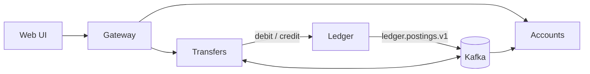

# mock-bank

A mock bank for learning, written in Rust and run locally with Docker Compose. Customers log in, see accounts and balances, and send transfers. Transfers are handled asynchronously as sagas: a transfer is accepted, queued, then moved step by step (debit, credit, done), with a reversal if a step fails.

Spec-driven: every feature has a spec in `specs/` before code.

## Roles

| Role | What it can do |
|------|----------------|
| `customer` | Log in, view own accounts and balances, manage payees, send transfers |
| `admin` | Create customers and accounts, fund accounts from treasury, run bulk transfers, verify balances against the ledger |
| `service` | Internal only: transfers workers post debits and credits to the ledger |

## High-level design

- **Gateway**: the only public entry point. Authenticates, rate-limits, routes.
- **Accounts**: customers, accounts, payees, sessions. Holds a read-only balance projection built from ledger events.
- **Ledger**: double-entry postings and balances. The source of truth, and the only place that enforces overdraft.
- **Transfers**: accepts a transfer (`202`), buffers it in Kafka, and runs it as a saga with compensation. Ordering is per source account.
- **Web**: server-rendered UI and admin console.
- **Infra**: Postgres (one schema per service), Kafka (events and the transfer queue, via outbox), Redis (sessions, rate limits, caching; phase 2).

## Docs

Diagrams and explanations live in [docs/](docs/README.md):

- [System flow](docs/platform/system-flow.md): components and the end-to-end transfer sequence
- [Saga runner](docs/saga/README.md): loop, states, crash recovery
- [Transfers](docs/transfers/README.md): [backpressure](docs/transfers/backpressure.md) and [ordering](docs/transfers/ordering.md)
- Services: [gateway](docs/gateway/README.md), [accounts](docs/accounts/README.md), [ledger](docs/ledger/README.md), [web](docs/web/README.md)

Specs are in [specs/](specs/README.md). Tasks are tracked in [TASKS.md](TASKS.md).
