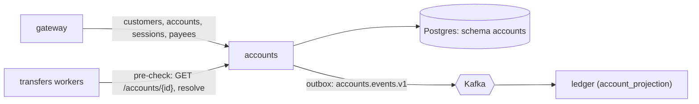

# Accounts

[Spec] [accounts/001-service](../../specs/accounts/001-service.md), [accounts/002-schema](../../specs/accounts/002-schema.md).

## Role
Owns customers, accounts, payees and login sessions. Knows no balances.

## API (internal, called by gateway; transfers workers use two read endpoints)
- `POST /customers`, `GET /customers` (admin).
- `POST /auth/login`, `GET|DELETE /sessions/{id}`.
- `POST|GET /accounts`, `GET /accounts/{id}`, `PATCH /accounts/{id}`.
- `GET /accounts/resolve?account_number=` (minimal fields; used by the transfers pre-check).
- `POST|GET /payees`, `DELETE /payees/{id}`.

## Data owned
Schema `accounts`: customers, accounts, payees, sessions, outbox.

## Events
- Out: `accounts.events.v1` (`AccountOpened`, `AccountClosed`), key `account_id`, via outbox.
- In: none.

## Interactions

