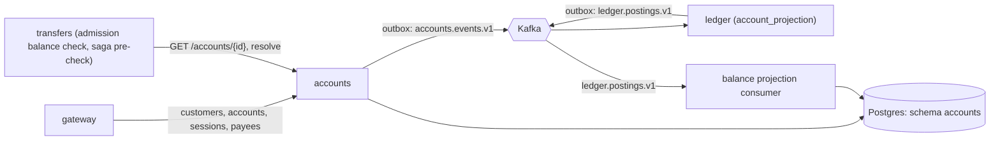

# Accounts

[Spec] [accounts/001-service](../../specs/accounts/001-service.md), [accounts/002-schema](../../specs/accounts/002-schema.md).

## Role
Owns customers, accounts, payees and login sessions. Keeps a read-only, eventually consistent balance projection (`account_balances`) built from `ledger.postings.v1`. Not authoritative: the ledger is.

## API (internal, called by gateway; transfers workers use two read endpoints)
- `POST /customers`, `GET /customers` (admin).
- `POST /auth/login`, `GET|DELETE /sessions/{id}`.
- `POST|GET /accounts`, `GET /accounts/{id}`, `PATCH /accounts/{id}`. Reads include `balance_minor` and `as_of` (when the balance was last updated from the ledger; `null` if no postings yet).
- `GET /accounts/resolve?account_number=` (minimal fields; used by the transfers pre-check).
- `POST|GET /payees`, `DELETE /payees/{id}`.

## Data owned
Schema `accounts`: customers, accounts, payees, sessions, `account_balances` (projection, written only by the consumer), `processed_events`, outbox.

## Events
- Out: `accounts.events.v1` (`AccountOpened`, `AccountClosed`), key `account_id`, via outbox.
- In: `ledger.postings.v1` (group `accounts-balances`): dedup on `event_id`, version-guarded upsert per account, rebuildable by replay. Metric `accounts_balance_projection_lag_seconds`, alert above 30 s for 2 min.

## Interactions

