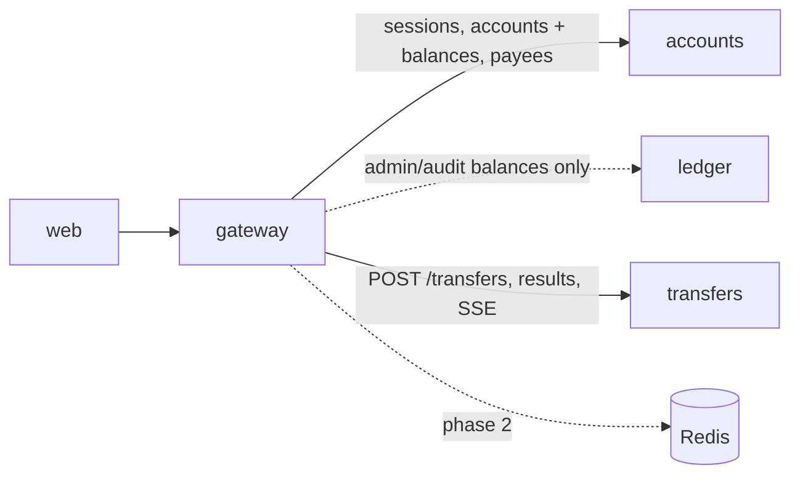

# Gateway

[Spec] [gateway/001-service](../../specs/gateway/001-service.md), [gateway/002-admin](../../specs/gateway/002-admin.md).

## Role
The single public REST API. Authenticates users (session cookie or admin token), mints an internal JWT, routes to accounts, ledger and transfers. Account pages need only accounts: balances come from its projection.

## API (public)
- Auth: `POST /auth/login`, `POST /auth/logout`, `GET /me`.
- Accounts: `GET|POST /accounts` (list includes `balance_minor` and `as_of`, eventually consistent; no ledger call, no `502` path), `GET /accounts/{id}/transfers`, payees (`/payees`).
- Transfers: `POST /transfers` (`Idempotency-Key`, returns `202`), `GET /transfers/{id}`, SSE `GET /transfers/{id}/events`.
- Admin (`X-Admin-Token`): `/admin/*` (customers, accounts, fund, bulk transfers, `GET /admin/accounts/{id}/balance` for the authoritative ledger balance).
- `GET /healthz`, `GET /readyz`.

## Data owned
None in Postgres. Redis (phase 2): sessions, rate limit buckets, idempotency fast path, balance cache (optional).

## Events
In: none. Out: none.

## Interactions

