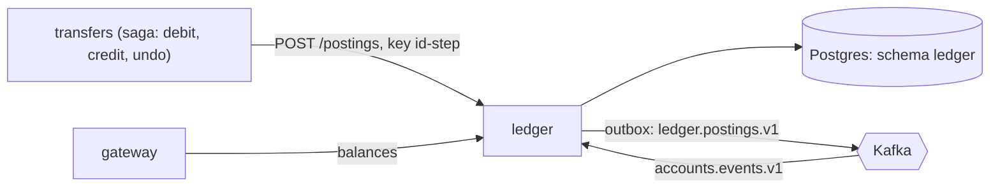

# Ledger

[Spec] [ledger/001-service](../../specs/ledger/001-service.md), [ledger/002-schema](../../specs/ledger/002-schema.md).

## Role
Source of truth for money: double-entry postings, balances, idempotency, treasury and transit accounts. Does not run the transfer workflow.

## API (internal)
- `POST /postings` (`Idempotency-Key`; `service` role only, called by transfers workers).
- `GET /accounts/{id}/balance`, `POST /balances/query` (gateway page composition).
- `GET /accounts/{id}/postings`, `GET /postings/{id}`.

## Data owned
Schema `ledger`: postings, entries, balances, idempotency records, `account_projection`, processed events, system accounts (`bank:treasury:<CUR>`, `bank:transit:<CUR>`), outbox.

## Events
- In: `accounts.events.v1` (builds `account_projection`).
- Out: `ledger.postings.v1` (`PostingPosted`), via outbox.

## Interactions

