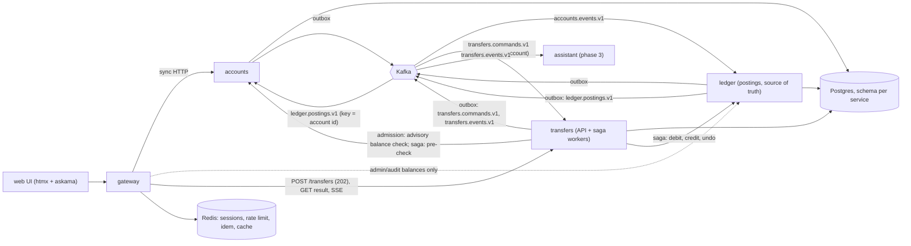
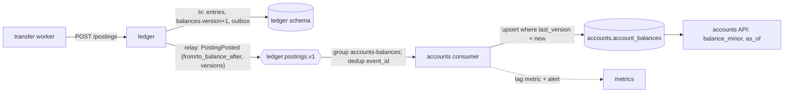
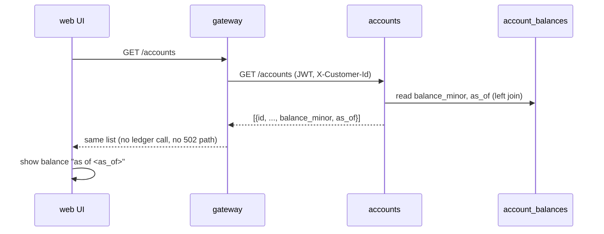
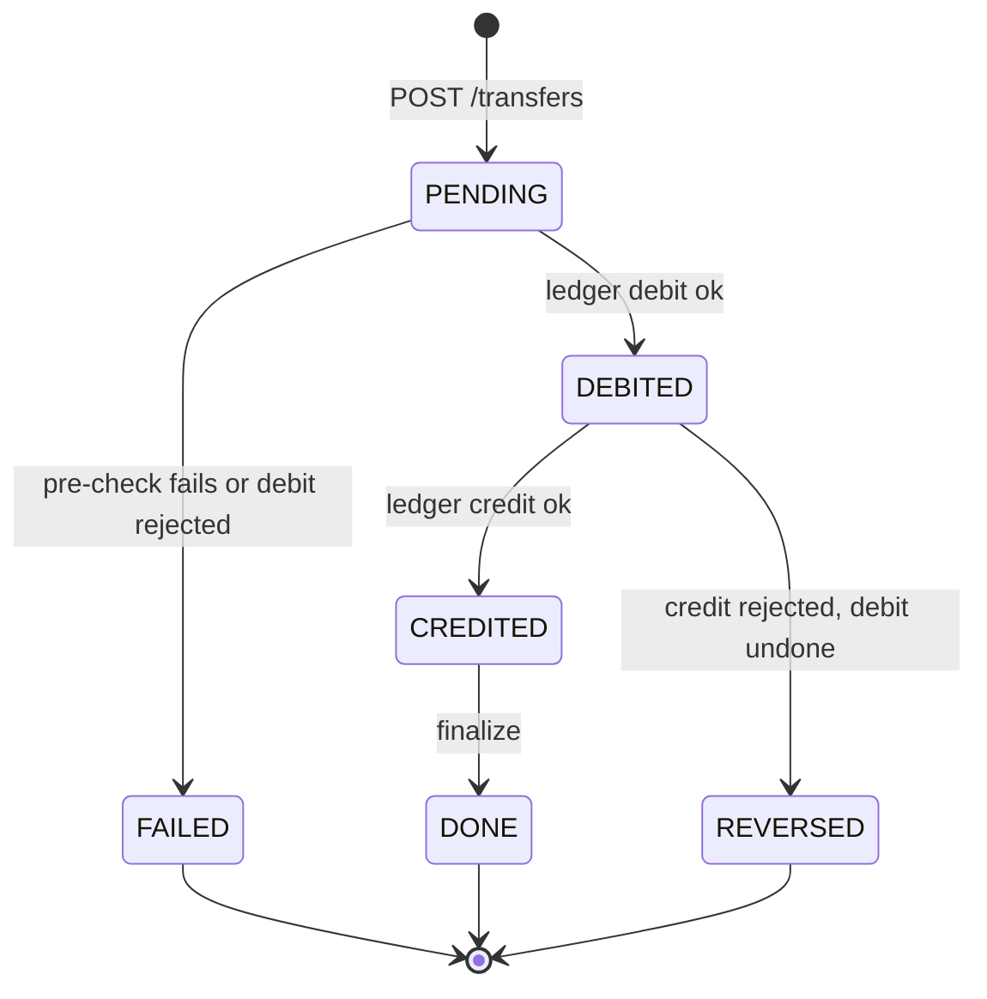

# System flow

Source: [specs/000-architecture.md](../../specs/000-architecture.md), [specs/transfers/001-service.md](../../specs/transfers/001-service.md), [specs/accounts/001-service.md](../../specs/accounts/001-service.md). Transfers are a separate **transfers** service. The **ledger** only does double-entry postings and is the single source of truth for balances. **Accounts** keeps an eventually consistent balance projection fed by the ledger.

## Components



- Users reach accounts, ledger and transfers only through the gateway. The one service-to-service exception is the transfers workers calling accounts (pre-check) and ledger (postings) in the saga.
- State moves between services via Kafka (ledger builds `account_projection` from `accounts.events.v1`; accounts builds `account_balances` from `ledger.postings.v1`; transfers queue their own commands on `transfers.commands.v1`).
- Redis is phase 2; assistant and MCP are phase 3-4 (see spec phases).

## Balance projection (ledger -> Kafka -> accounts)



Each posting event carries the resulting balance and a per-account version for both accounts. Apply is a version-guarded set, so duplicates and out-of-order events change nothing, and replaying the topic rebuilds the table. The projection is read-only, eventually consistent and not authoritative.

## Balance read (sequence)



After a transfer reaches `done` the source balance may briefly show the old value. The UI marks it "updating" and re-fetches `GET /accounts` (1 s, up to 10 s) until `as_of` moves past the value it captured earlier. Admin audit reads call the ledger through `GET /admin/accounts/{id}/balance`.

## Transfer sequence (async)

```mermaid
sequenceDiagram
  participant UI as web UI
  participant GW as gateway
  participant T as transfers API
  participant DB as Postgres (transfers)
  participant K as Kafka
  participant W as transfer worker
  participant A as accounts
  participant L as ledger
  UI->>GW: POST /transfers (Idempotency-Key)
  GW->>GW: auth, rate limit (429 + Retry-After)
  GW->>T: POST /transfers
  T->>T: admission (backlog, lag): 503 + Retry-After if over
  T->>A: GET /accounts/{from} (projected balance, advisory)
  A-->>T: balance_minor, as_of
  T-->>GW: 422 insufficient_funds + as_of if balance < amount (no rows written)
  T->>DB: BEGIN; insert transfer PENDING + outbox (command, transfer.created); COMMIT
  T-->>GW: 202 {transfer_id}
  GW-->>UI: 202 {transfer_id}
  UI->>GW: GET /transfers/{id}/events (SSE) or poll GET /transfers/{id}
  T->>K: relay publishes command (key = source account)
  K->>W: transfers.commands.v1
  W->>A: pre-check (owner, open, currency)
  W->>L: debit: customer to transit (key id-debit)
  L-->>W: ok (or 422 insufficient_funds -> FAILED)
  W->>DB: DEBITED + outbox transfer.debited
  W->>L: credit: transit to destination (key id-credit)
  L-->>W: ok (or rejected -> undo, key id-debit-undo -> REVERSED)
  W->>DB: CREDITED, then DONE + outbox transfer.completed
  T->>K: relay publishes transfer.* on transfers.events.v1
  T-->>UI: SSE final state; UI replaces "processing"
```

The balance check at admission is advisory and fail-open; a stale projection can false-pass (transfer ends `FAILED` at the ledger debit) or false-reject right after a credit (retry succeeds once the projection catches up). The client does not get instant success or failure: `202` only means accepted. The UI shows "processing" until a final state (`DONE`, `FAILED`, `REVERSED`).

## Saga state



The progress is saved in the `sagas` row (mirrored in `transfers.status`), so a crashed worker resumes from the saved state. There is no internal reversing state: while the saga's `failure_reason` is set the runner runs the undo steps in reverse. See [../saga/README.md](../saga/README.md).

## Account page

Gateway calls accounts only; the list includes `balance_minor` and `as_of` from the projection (see the balance read sequence). A balance reflects a transfer once its posting events are consumed, so it can trail the ledger by the consumer lag. Redis balance cache (phase 2) is optional.

## Guarantees

- Double entry: entries sum to 0 per posting; the transit account is zero when nothing is in flight.
- Idempotent writes: client `Idempotency-Key` on the transfer; ledger keys `{transfer_id}-{step}` and `{transfer_id}-{step}-undo`.
- Per-account ordering: Kafka key = source account id.
- Events at-least-once; consumers dedup on `event_id`.
- The ledger enforces overdraft on the debit and never reads the projection. The accounts check and the projected-balance check at admission are advisory except ownership.
- Balance projection: dedup on `event_id`, per-account order by version, idempotent upsert, rebuildable by replay; lag metric `accounts_balance_projection_lag_seconds` with alerts.
