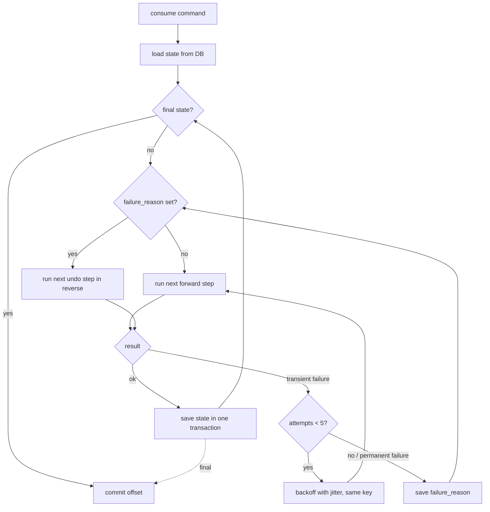
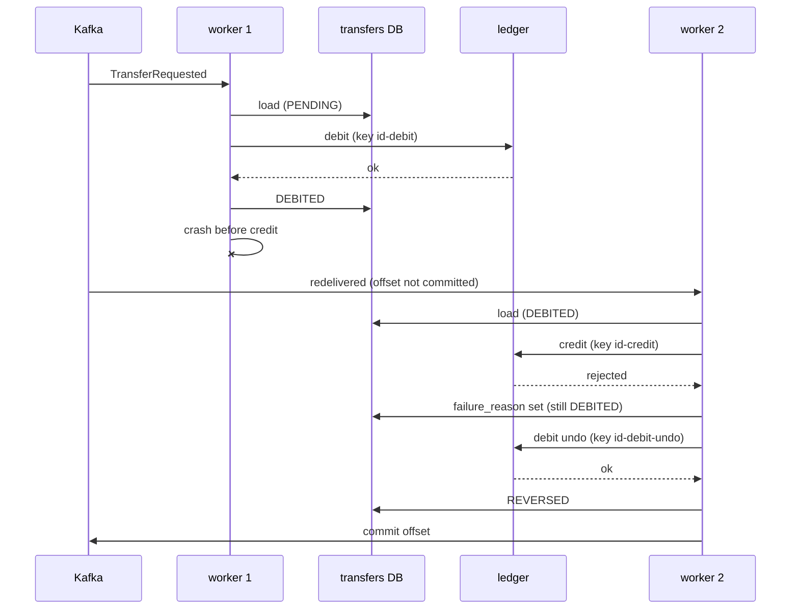

# Saga worker pattern

[Spec] for the transfer saga ([specs/transfers/001-service.md](../specs/transfers/001-service.md)). The generic model below is an explanation, not a spec change.

## Worker loop



- Transient failure (timeout, 5xx): retry with the same idempotency key, up to 5 attempts.
- Permanent failure (business rejection, or retries used up): save `failure_reason`, then run the undo steps in reverse. Nothing done yet: go straight to `FAILED`.
- Undo steps retry without limit and alert.
- The offset is committed only after a final state.

## Crash and resume



If worker 1 crashed after the ledger call but before saving, worker 2 repeats the debit with the same key and gets the stored response (a replay), so money moves once.

## Generic model

A saga is an ordered list of steps.

| Field | Meaning |
|---|---|
| action | the forward call |
| undo | the compensating call, or none |
| idempotency key | template `{saga_id}-{step}`; undo uses `{saga_id}-{step}-undo` |
| retry policy | attempts, backoff, give-up behavior |

State table shape:

```
sagas (
  saga_id        uuid primary key,
  type           text,     -- which step list
  current_step   text,     -- last completed step
  status         text,     -- in progress | DONE | FAILED | REVERSED
  failure_reason text,     -- set = run undo steps in reverse
  payload        jsonb
)
```

Rules
- Every step and every undo is idempotent (same key, same effect).
- State is saved in the same transaction as the step's result event.
- Undo runs in reverse order of the completed steps.
- Steps that cannot be undone go last. The first one is the point of no return: after it the saga can only move forward.

The transfer is one step list:

| Step | Action | Undo | Key |
|---|---|---|---|
| debit | customer -> transit | transit -> customer | `{id}-debit` / `{id}-debit-undo` |
| credit | transit -> destination | none (see below) | `{id}-credit` |
| done | finalize, emit `transfer.completed` | none | n/a |

If credit is rejected, the debit is undone. Once credit succeeds only `done` is left, which cannot fail on business grounds.

Other sagas could use the same loop with a different step list, for example a loan payout (check, reserve funds, pay out, notify) as an illustration only. Not specced.
