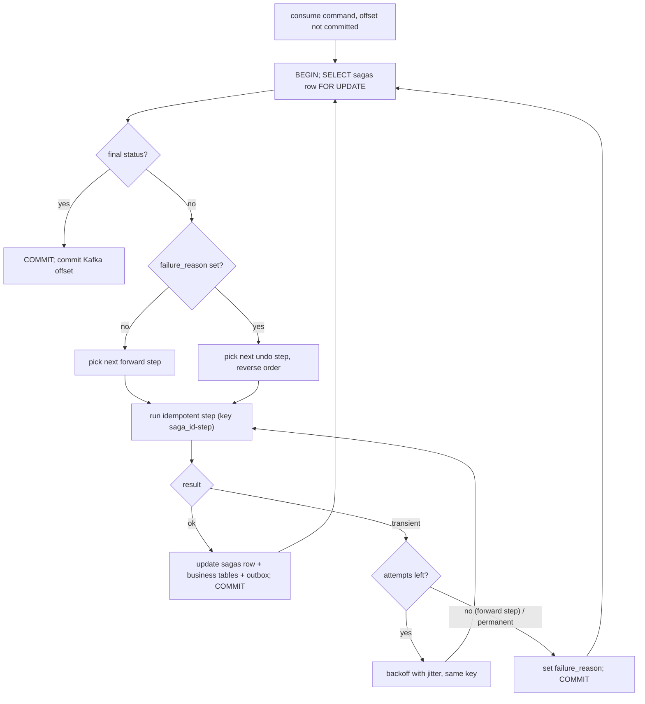
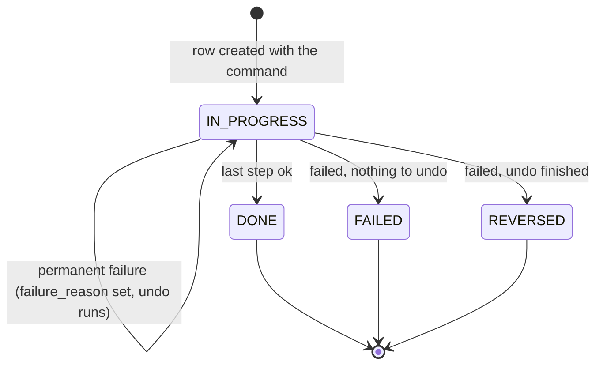

# Saga runner

[Spec] [specs/common/006-saga.md](../../specs/common/006-saga.md). Transfers is the first saga type ([specs/transfers/001-service.md](../../specs/transfers/001-service.md), steps `debit`, `credit`, `done`).

A saga is an ordered list of steps run by one generic runner. The runner keeps state in a `sagas` table, so any pod can resume it after a crash.

## Step model

| Field | Meaning |
|---|---|
| action | the forward call, idempotent |
| undo | the compensating call, or none |
| idempotency key | `{saga_id}-{step}`; undo uses `{saga_id}-{step}-undo` |
| retry policy | attempts, backoff with jitter, give-up behavior |

```
sagas (saga_id pk, type, current_step, status, failure_reason, payload, updated_at)
status: IN_PROGRESS | DONE | FAILED | REVERSED
```

Rules
- Every step and undo is idempotent (same key, same effect).
- Undo runs in reverse order of the completed steps.
- Non-undoable steps go last. The first one is the point of no return.
- `failure_reason` set means: run undo steps, not forward steps.

Transfer step list

| Step | Action | Undo | Key |
|---|---|---|---|
| debit | pre-check, then customer -> transit | transit -> customer | `{id}-debit` / `{id}-debit-undo` |
| credit | transit -> destination | none | `{id}-credit` |
| done | finalize, emit `transfer.completed` | none | n/a |

Other saga types would reuse the runner with a different step list (illustration only, not specced).

## Runner loop



- The offset is committed last, only when the saved row is final.
- Transient failure: retry with the same key. Undo steps retry without limit and alert.
- Permanent failure: save `failure_reason`, undo done steps in reverse. Nothing done: `FAILED`. Undo finished: `REVERSED`.

## Saga status



## Crash recovery

State is saved in one transaction per step; the offset is committed after. Three crash points:

```mermaid
sequenceDiagram
  participant K as Kafka
  participant W1 as worker 1
  participant DB as sagas table
  participant S as callee (ledger)
  participant W2 as worker 2
  participant SW as sweeper
  K->>W1: command
  W1->>DB: SELECT FOR UPDATE
  Note over W1: crash point 1: before the step runs
  W1-xW1: crash
  K->>W2: redelivered (offset not committed)
  W2->>DB: SELECT FOR UPDATE, step not done
  W2->>S: run step (key id-step)
  S-->>W2: ok
  Note over W2: crash point 2: after the step, before the save
  W2-xW2: crash
  K->>W1: redelivered
  W1->>S: run step again (same key)
  S-->>W1: stored response (replay, no second effect)
  W1->>DB: UPDATE current_step; COMMIT
  Note over W1: crash point 3: after the save, before the offset commit
  W1-xW1: crash
  K->>W2: redelivered
  W2->>DB: SELECT FOR UPDATE, row is ahead
  W2->>S: next step
  W2->>DB: UPDATE; COMMIT
  W2->>K: commit offset (last)
  Note over SW,DB: command lost? sweeper finds IN_PROGRESS rows with stale updated_at and re-enqueues via outbox
```

- Row lock: two pods on one saga serialize on `FOR UPDATE`; the second reloads the row and continues from `current_step`.
- Sweeper: re-enqueues `IN_PROGRESS` sagas with stale `updated_at` (default 60 s). Safe because the runner is idempotent.
- Replay: the callee returns the stored response for a repeated key, so money moves once.
