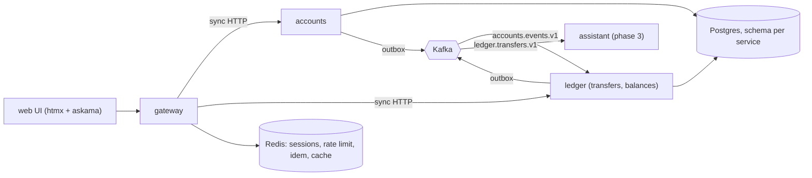
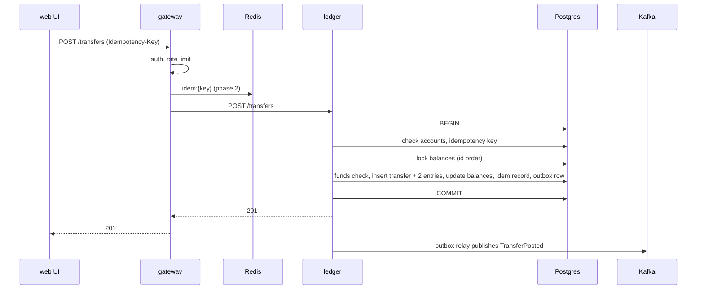

# System flow

Source: [specs/000-architecture.md](../specs/000-architecture.md). Note: there is no separate "transfers" service. Transfers live in the **ledger**.

## Components

- Only the gateway calls accounts and ledger (sync). Services never call each other over HTTP.
- State moves between services via Kafka (ledger builds `account_projection` from `accounts.events.v1`).
- Redis is phase 2; assistant and MCP are phase 3-4 (see spec phases).

## Transfer sequence

## Account page

Gateway calls accounts (list) and ledger (balances), then composes the page. Redis balance cache sits in front of the ledger call (phase 2).

## Guarantees

- Double entry: entries sum to 0 per transfer.
- Idempotent writes (`Idempotency-Key`).
- Events at-least-once; consumers dedup on `event_id`.
