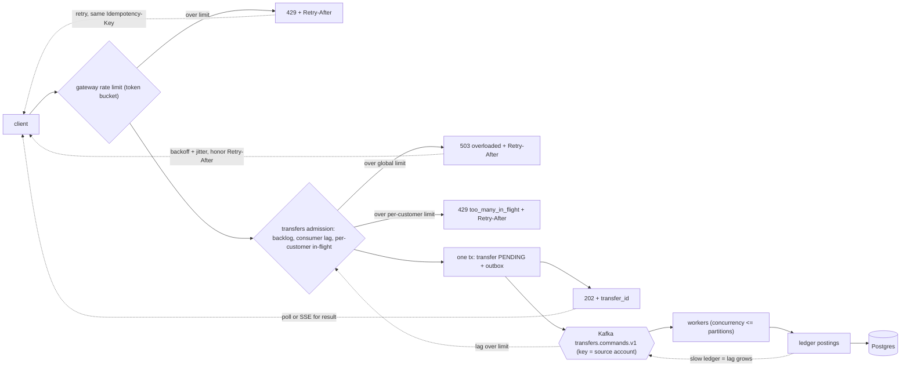

# Transfers under load (backpressure)

When transfers are busy, the system slows callers down instead of falling over. Transfers are accepted into a bounded queue; the ledger is protected behind it.

Legend: **[Spec]** in specs. **[Proposal]** not yet specced. The core of this page is now Spec ([transfers/001-service](../specs/transfers/001-service.md)).

## What the specs say

- [Spec] Gateway: Redis token bucket per user and per IP, `429` with `Retry-After` (phase 2; gateway/001, platform/003).
- [Spec] Transfers admission control before the insert: global backlog (`TRANSFERS_MAX_BACKLOG`, default 10000) and consumer lag (`TRANSFERS_MAX_LAG`, default 5000) -> `503 overloaded`; per-customer in-flight (`TRANSFERS_MAX_PER_CUSTOMER`, default 50) -> `429 too_many_in_flight`; always with `Retry-After` and nothing written, so a retry with the same key is safe (transfers/001).
- [Spec] Kafka (`transfers.commands.v1`) is the buffer between accepting and processing. Workers drain at the ledger's pace; a slow ledger grows lag, which trips admission, so the ledger is never flooded.
- [Spec] Idempotency: client `Idempotency-Key` stored on the transfer row; same key + same body returns the same `transfer_id`; different body is `422`.
- [Spec] R4 (platform/003): timeouts on every network call, bounded pools and queues, overload returns 503/429 with `Retry-After`; small DB pools plus PgBouncer or RDS Proxy.
- [Spec] The saga retries transient ledger errors (including `409 account_not_ready`) with the same step key, 5 attempts, then fails or reverses.
- [Spec] Metrics: backlog, consumer lag, step latency, time-to-final, admission rejections, plus pool wait, RED, outbox lag. The p99 < 200 ms SLO applies to accepting (`POST /transfers`), not to time-to-final.
- [Spec] Trade-off: the client gets `202`, not the result. It polls `GET /transfers/{id}` or uses SSE `GET /transfers/{id}/events`; the UI shows "processing".

## Proposal (not in specs yet)

- Numbers: bucket size and refill per user (e.g. burst 10, 5/s); per-pod concurrency (e.g. 2x DB pool size).
- Shed order under load: cached reads first, then non-admin transfers; admin funding last.
- `Retry-After` tuning: for 429 from bucket refill time; for 503 an estimate from backlog / completion rate plus jitter (spec gives the idea, exact formula is open).
- Alert on backlog, lag, pool wait and 503 rate.

## Why retries are safe

A retry after a timeout may hit a transfer that is already accepted. Transfers returns the same `transfer_id` for the same key and body, so there is no second command. Inside the saga, a repeated ledger call with the same step key returns the stored response, so there is no double debit.
