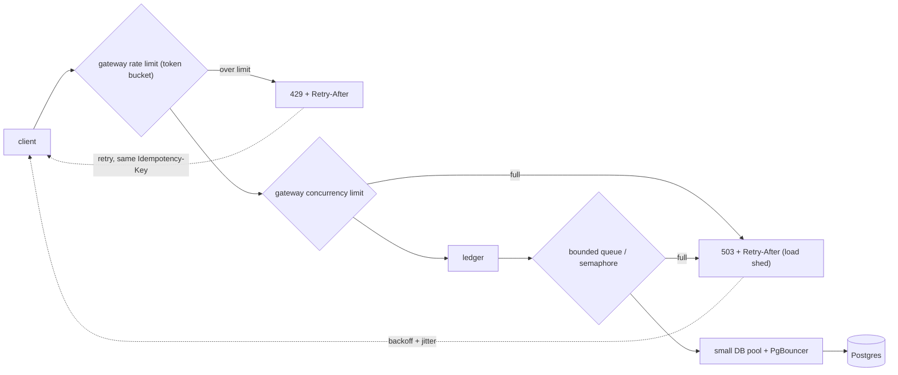

# Transfers under load (backpressure)

When the ledger (transfer path) is busy, the system should slow callers down instead of falling over.

Legend: **[Spec]** already in specs. **[Proposal]** not yet specced.

## What the specs say

- [Spec] R4: timeouts on every network call, bounded pools and queues, overload returns 503/429 with `Retry-After` (platform/003).
- [Spec] Rate limiting: Redis token bucket per user and per IP at the gateway, plus an in-process per-pod limit (architecture section 4, platform/003). Exceeding returns `429` (phase 2 acceptance).
- [Spec] Gateway concurrency limit and load shedding; small DB pools plus PgBouncer or RDS Proxy (platform/003).
- [Spec] Idempotency: `Idempotency-Key` required on writes; ledger stores the response; same key + same body replays (ledger/001). Redis `idem:{key}` fast path in phase 2.
- [Spec] Metrics: pool wait, RED, outbox and consumer lag. SLO p99 < 200 ms.
- [Spec] `409 account_not_ready` is retriable with the same key; bulk admin retries it with backoff.

## Proposal (not in specs yet)

- Numbers: bucket size and refill per user (e.g. burst 10, 5/s); per-pod concurrency (e.g. 2x DB pool size).
- Ledger: bounded semaphore in front of the transfer handler, wait limit (e.g. 200 ms), then `503 Retry-After: 1`.
- Shed order: cached reads first, then non-admin transfers; never skip the idempotency check.
- Client rule: retry only 429/503/timeouts, same `Idempotency-Key`, exponential backoff with jitter, honor `Retry-After`.
- `Retry-After`: for 429 from bucket refill time; for 503 a small fixed value plus jitter.
- Alert on pool wait and 503 rate.

## Why retries are safe

A retry after a timeout may hit a transfer that already committed. The ledger returns the stored response for the same key and body, so there is no double debit.
