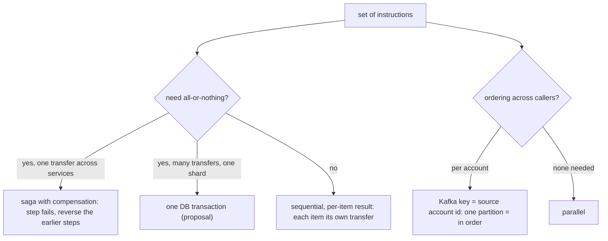
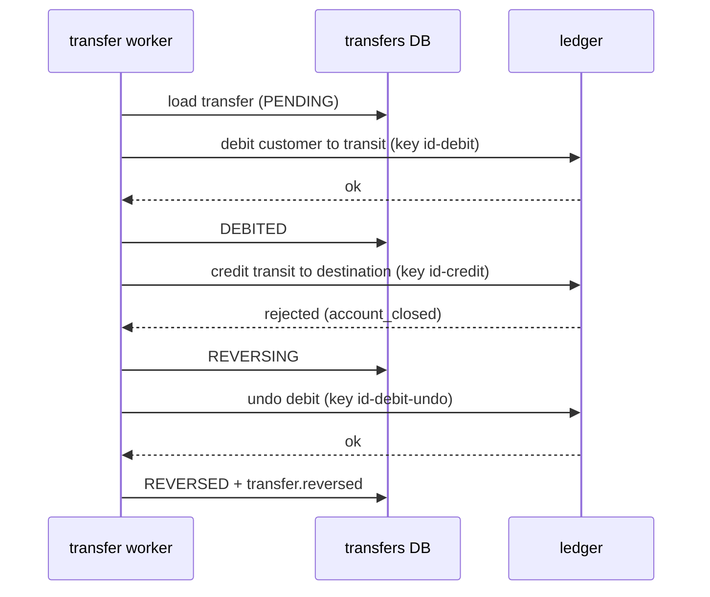

# Running transfer instructions in order

When a set of instructions must run one after another.

Legend: **[Spec]** in specs. **[Proposal]** not yet specced. The single-transfer saga and per-account ordering are now Spec ([transfers/001-service](../specs/transfers/001-service.md)).

## What the specs say

- [Spec] A transfer is a saga in the transfers service: pre-check, ledger debit, ledger credit, with a compensating reversal posting if the credit is rejected. State `PENDING -> DEBITED -> CREDITED -> DONE | FAILED | REVERSED` is persisted per transfer, so a crash resumes from the saved state (transfers/001, transfers/002).
- [Spec] Each ledger call has an idempotency key: `{transfer_id}-{step}` forward and `{transfer_id}-{step}-undo` for compensation. A repeated call is a replay.
- [Spec] Compensation is a new reversing posting (`{transfer_id}-debit-undo`), never a delete: ledger entries are append-only (ledger/002).
- [Spec] Per-account ordering: commands go to `transfers.commands.v1` keyed by source account id. Same account = same partition = processed one at a time, in order. Different accounts run in parallel. The offset is committed after the saga reaches a final state.
- [Spec] A single ledger posting is one DB transaction; both `balances` rows are locked in account-id order, so opposing postings do not deadlock (ledger/001).
- [Spec] Bulk admin transfers are sequential, in order, **not atomic**: each item is its own transfer with key `{batch}-{i}`; a failure does not stop or roll back others; resubmit-safe (gateway/002-admin). Execution order is per source account via the Kafka key.
- [Spec] The outbox relay publishes same-key rows sequentially and stops the batch at a failed row (common/005). Run one relay per service to keep key order.
- [Spec] Consumers are at-least-once with `event_id` dedup; the saga handler is idempotent via the saved state and step keys.
- [Spec] Cross-shard transfers: delayed credit via a per-shard clearing account and outbox event (design only, P4). The transit account plays this role in the current saga. 2PC rejected.

## Proposal (not in specs yet)

1. **Atomic batch, one shard**: one transaction, many instructions applied in order. Collect all accounts first, lock in sorted account-id order, then apply. Any failure rolls back the whole batch. Key: one batch key plus request hash. (The spec's bulk is non-atomic.)
2. **Multi-transfer sagas** (a batch that must succeed or be fully reversed): chain several transfers under one parent saga id. Not specced.
3. **Deadlocks**: always lock in sorted id order (Spec for postings); generic retry on Postgres deadlock or serialization errors with the same key is a proposal.
