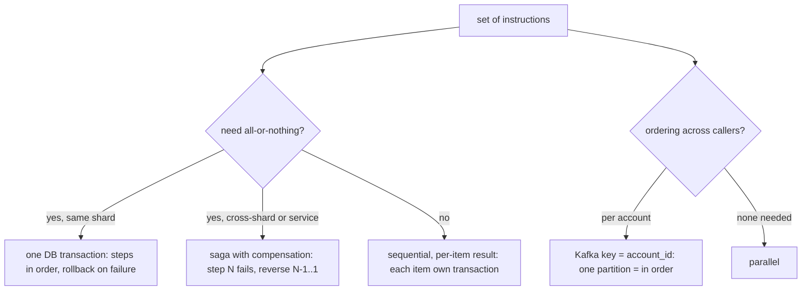
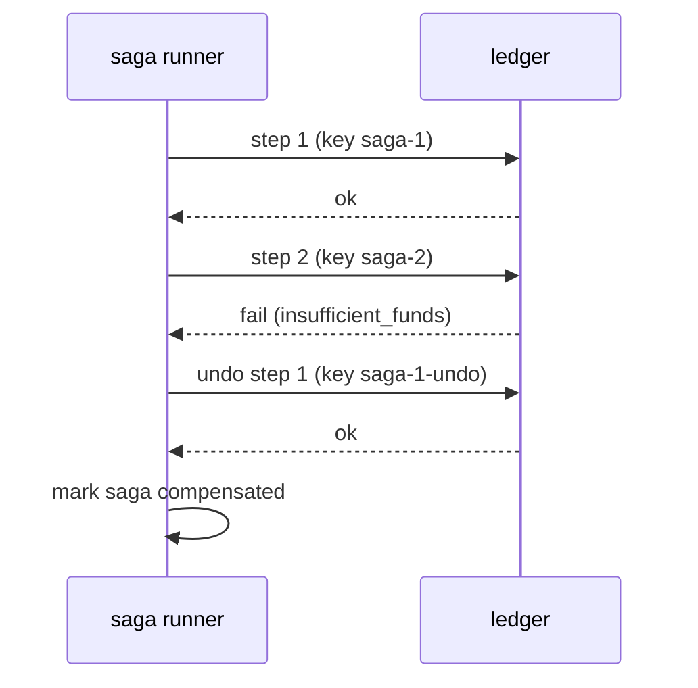

# Running transfer instructions in order

When a set of instructions must run one after another.

Legend: **[Spec]** in specs. **[Proposal]** not yet specced.

## What the specs say

- [Spec] Bulk transfers are sequential, in order, **not atomic**: each item is its own transfer with key `{batch}-{i}`; a failure does not stop or roll back others; resubmit-safe (gateway/002-admin).
- [Spec] A single transfer is one DB transaction (ledger/001). Both `balances` rows are locked in account-id order, so opposing transfers do not deadlock.
- [Spec] Kafka ordering is per partition key (`account_id`), no global ordering. The outbox relay publishes same-key rows sequentially and stops the batch at a failed row (common/005). Run one relay per service to keep key order.
- [Spec] Consumers are at-least-once with `event_id` dedup, so replays are safe.
- [Spec] Cross-shard transfers: delayed credit via per-shard clearing account and outbox event (design only, P4). 2PC rejected.

## Proposal (not in specs yet)

1. **Atomic batch, one shard**: one transaction, instructions applied in order. Collect all accounts first, lock in sorted account-id order, then apply. Any failure rolls back the whole batch. Key: one batch key plus request hash.
2. **Saga with compensation** (cross-shard or multi-service): persist saga state (`step`, `status`) in Postgres. Each step has an idempotent forward action and a compensating action (a reversing transfer, never a delete, since entries are append-only). Resume from saved state after a crash.
3. **Per-account ordering**: for Kafka input, key by `account_id`, handle one message at a time per partition, commit offset after processing. For HTTP, serialize per account with the row lock.
4. **Idempotency**: step key `{saga_id}-{step}`, compensation key `{saga_id}-{step}-undo`.
5. **Deadlocks**: always lock in sorted id order; retry on Postgres deadlock or serialization errors with the same key.

