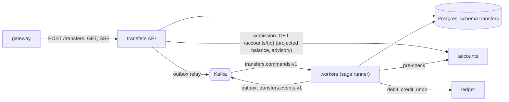

# Transfers

[Spec] [transfers/001-service](../../specs/transfers/001-service.md), [transfers/002-schema](../../specs/transfers/002-schema.md). First saga type on the [saga runner](../saga/README.md).

## Role
Customer-facing transfer workflow. Accepts a transfer fast (`202`), queues it on Kafka, runs the `transfer` saga (`debit`, `credit`, `done`) against accounts (pre-check) and ledger (postings), publishes results.

## API (internal, called by gateway)
- `POST /transfers` (`Idempotency-Key`) -> `202`; `429`/`503` + `Retry-After` under load; `422 insufficient_funds` (with `as_of`) when the accounts balance projection already shows too little. That check is advisory and fail-open, writes no `transfers`/`sagas` row, and leaves the authoritative check to the ledger debit. A stale projection can false-pass (ends `FAILED` at the debit) or false-reject right after a credit.
- `GET /transfers/{id}`, SSE `GET /transfers/{id}/events`.
- `GET /accounts/{id}/transfers`.

## Data owned
Schema `transfers`: `transfers` (business fields, mirror `status`), `sagas` (progress), `outbox`.

## Events
- In: `transfers.commands.v1` (key = source account id).
- Out: `transfers.events.v1` (`transfer.created|debited|completed|failed|reversed`), `transfers.commands.v1`, via outbox.

## Interactions

More: [backpressure](backpressure.md), [ordering](ordering.md).
