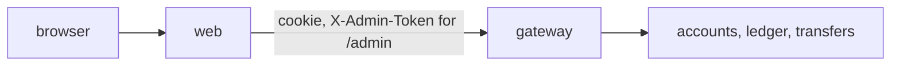

# Web

[Spec] [web/001-service](../../specs/web/001-service.md), [web/002-admin](../../specs/web/002-admin.md).

## Role
Server-rendered UI (axum + askama + htmx) for customers: login, accounts, transactions, transfers, payees. Admin console under `/admin` (customers, accounts, funding, bulk transfers). Calls the gateway only.

## API
Pages: `/login`, `/accounts`, `/accounts/{id}`, `/transfer`, `/payees`, `/admin/*`. A transfer submit returns a "processing" fragment that polls (or uses SSE) until the state is `done`, `failed` or `reversed`.

Balances are eventually consistent and always shown with their `as_of`. After `done` the source balance is marked "updating" and `GET /accounts` is re-fetched (1 s, up to 10 s) until `as_of` advances. An early `422 insufficient_funds` is shown with the `as_of` and a hint to retry if money was just received.

## Data owned
None.

## Events
In: none (SSE from gateway for transfer results). Out: none.

## Interactions

