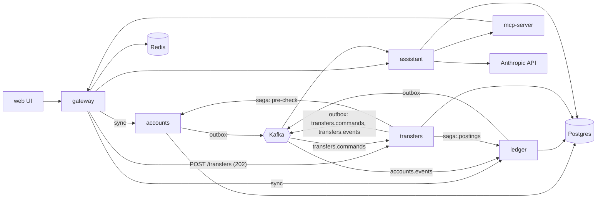

# 000 Architecture

Status: draft. All data is synthetic. Runs locally via Docker Compose.

## 1. Goals and non-goals

Goals
- Learn Rust (axum, sqlx, tokio), Kafka, Redis, Postgres, vector search and AI by building a small but realistic bank.
- Correct money handling: double-entry ledger, idempotent writes, no lost events.
- Everything starts with `docker compose up`.

Non-goals
- Real money, real PII, real payment rails, KYC, regulatory compliance.
- Multi-region. Kubernetes deployment is supported but optional; see [platform/003-scale-and-portability](platform/003-scale-and-portability.md).
- Production-grade security (local dev only).

## 2. Component view



## 3. Services

All services are Rust (edition 2021+), `axum` for HTTP, `sqlx` for Postgres, `tokio` runtime, `tracing` for logs.

| Service | Responsibility | Owned data |
|---|---|---|
| accounts | Customers, accounts, account status, saved payees. Publishes `accounts.events.v1` via outbox. Knows no balances. | schema `accounts`: `customers`, `accounts`, `payees`, `outbox` |
| ledger | Source of truth for money. Double-entry postings, balances, idempotency, system accounts (treasury, transit). No transfer workflow. Keeps a read-only projection of accounts built from `accounts.events.v1`. Publishes events via outbox. | schema `ledger`: `postings`, `entries`, `balances`, `idempotency_keys`, `account_projection`, `outbox` |
| transfers | Customer-facing transfer workflow. Accepts transfers (202), queues them on Kafka, runs a resumable saga on the generic saga runner (`common/006-saga`; steps debit, credit, done), serves results (poll, SSE). Publishes `transfer.*` events via outbox. | schema `transfers`: `transfers`, `sagas`, `outbox` |
| gateway | Single public API (BFF). Auth, rate limiting, routing. The only caller of accounts, ledger and transfers on behalf of users. Composes account pages (accounts list + ledger balances). | Redis only (sessions, rate limits) |
| assistant | RAG question answering and the agent loop. Calls Anthropic. Owns embeddings and chat history. | schema `assistant`: `documents`, `embeddings` (pgvector), `conversations`, `approvals` |
| mcp-server | Exposes banking API as MCP tools. Thin adapter over gateway; no data. | none |
| web UI | Browser app: login, accounts, transactions, transfer form, assistant chat, approval prompts. htmx + server-rendered askama templates (Rust). | none |

Rules
- A service only writes to its own schema. No SQL joins across schemas.
- Services never call each other over HTTP, with one exception: the transfers workers call accounts (pre-check) and ledger (postings) as part of the saga. Otherwise only the gateway calls services synchronously (commands and queries).
- All cross-service state propagation is via Kafka events (e.g. ledger's `account_projection` from `accounts.events.v1`).
- Money amounts are integer minor units (`i64`) plus currency code. No floats.

## 4. Data stores

Postgres (one instance, one database, one schema per service, one DB role per schema)
- Migrations via `sqlx migrate`, kept per service as `migrations/<service>/NNNN_description.sql`. Full DDL: `accounts/002-schema`, `ledger/002-schema`, `transfers/002-schema`.
- Ledger invariants enforced in DB: `sum(entries.amount) = 0` per posting (checked in transaction and by a periodic audit query), entries are append-only (no UPDATE/DELETE grants).

Vector store
- Start with `pgvector` in the `assistant` schema (HNSW index, cosine).
- Optional later: Qdrant behind a `VectorStore` trait to compare. Switch by config.

Redis uses
- Sessions: `session:{id}` with TTL.
- Cache (phase 2): balance and recent-transactions reads, `cache:balance:{account_id}`, short TTL, invalidated by ledger events. Sits in front of the gateway's ledger call.
- Rate limits: token bucket per user and per IP at the gateway (`429`). Transfers admission control is separate and bounded by backlog and consumer lag (`transfers/001-service`).
- Idempotency keys (phase 2): fast-path lookup `idem:{key}` at the gateway (SET NX with TTL). The transfers table (client key) and the ledger table (step keys) are the durable source of truth.

## 5. Kafka

Single broker (KRaft mode, no ZooKeeper) locally. Retention for `accounts.events.v1` is infinite locally (3 partitions, no compaction); new or wiped consumers replay from earliest to rebuild projections.

| Topic | Producer | Consumers | Key | Purpose |
|---|---|---|---|---|
| `transfers.commands.v1` | transfers (outbox relay) | transfers workers (group `transfers-workers`) | `account_id` of source account | Transfer commands: buffer plus per-account ordering |
| `transfers.events.v1` | transfers (outbox relay) | SSE fan-out in transfers, assistant (embedder), cache invalidator | `account_id` of source account | `transfer.created/debited/completed/failed/reversed` |
| `ledger.postings.v1` | ledger (outbox relay) | cache invalidator | `account_id` of source account | Posting posted |
| `accounts.events.v1` | accounts (outbox relay) | ledger (projection), assistant | `account_id` | Account opened / closed / updated |
| `assistant.audit.v1` | assistant | none initially (log sink) | `conversation_id` | Agent tool calls and approvals |
| `*.dlq.v1` | consumers | manual | original key | Poison messages |

Event envelope (defined in `common/004-events-kafka`; plain JSON, versioned by topic name and `schema_version` field; no Avro/Protobuf/schema registry):
```json
{ "event_id": "uuid", "type": "PostingPosted", "occurred_at": "RFC3339",
  "schema_version": 1, "aggregate_id": "transfer uuid", "payload": { } }
```
`PostingPosted` payload (ledger): `posting_id, transfer_ref, from_account, to_account, amount_minor, currency, memo, posted_at`. `transfer.*` payloads: `transfers/001-service`.

Delivery semantics
- Producers: at-least-once, `acks=all`, idempotent producer enabled (`common/004-events-kafka`).
- Consumers: at-least-once with manual offset commit after processing; handlers are idempotent via `event_id` dedup table.
- Ordering: guaranteed per partition key (per account). No global ordering.
- 3 partitions per topic locally.

Outbox pattern (ledger, accounts and transfers; implemented once in `common/005-outbox`, schema in `accounts/002-schema`, `ledger/002-schema` and `transfers/002-schema`)
1. In the same Postgres transaction as the state change (a posting, a transfer transition), insert a row into the service's `outbox` (`id, topic, key, payload, created_at, published_at`).
2. A relay task in the service polls unpublished rows (`FOR UPDATE SKIP LOCKED`), publishes to Kafka, then sets `published_at`.
3. Crash between publish and mark causes a duplicate, which consumers tolerate via `event_id`.

## 6. Key flows

Create transfer (async saga; `transfers/001-service`)
1. UI sends `POST /transfers` with header `Idempotency-Key` to the gateway.
2. Gateway authenticates, rate limits (`429` + `Retry-After`), checks `idem:{key}` in Redis (phase 2), forwards to transfers.
3. Transfers checks admission (backlog, consumer lag, per-customer in-flight; over limit -> `503`/`429` + `Retry-After`). In one transaction it inserts the `transfers` row (`PENDING`) and the outbox rows (command, `transfer.created`). Same key + same body returns the same `transfer_id`; different body returns 422. It returns `202 {transfer_id}`.
4. The outbox relay publishes the command to `transfers.commands.v1`, keyed by source account id (buffer; same account in order, different accounts in parallel).
5. A transfer worker runs the saga, persisting state in the `sagas` row (mirrored as `PENDING -> DEBITED -> CREDITED -> DONE | FAILED | REVERSED`; resumable after a crash): accounts pre-check (advisory; ownership mandatory), ledger debit (customer to `bank:transit:<CUR>`, key `{transfer_id}-debit`; the ledger enforces overdraft), ledger credit (transit to destination, key `{transfer_id}-credit`). If the credit is rejected, a reversal posting (key `{transfer_id}-debit-undo`) returns the funds.
6. Each state change enqueues a `transfer.*` event. The client learns the result by polling `GET /transfers/{id}` or SSE `GET /transfers/{id}/events`; the UI shows "processing" until a final state.

Trade-off: the client no longer gets an instant success or failure.

Ledger posting (double-entry + idempotency; `ledger/001-service`): called by the transfers workers only. In one DB transaction: resolve both accounts in `account_projection` (unknown -> `409 account_not_ready`, retriable with the same key; closed -> 422; currency mismatch -> 422); idempotency lookup; lock both balance rows in id order; check funds (treasury may go negative); insert `postings` row, two `entries`, update `balances`, idempotency record, outbox row.

A transfer targets a destination account number (generated, human-readable). A closed-account race window (close event not yet projected, or account closed after the pre-check) is handled by the credit step failing and the debit being reversed.

Account page
- Gateway calls accounts for the account list and ledger for balances, then composes the page. Redis balance cache (phase 2) sits in front of the ledger call.

System accounts
- `bank:treasury` (one per currency) funds new accounts via ordinary transfers. It is the only account allowed to go negative; the zero-sum invariant still holds. Invisible to customers. Only a service/admin credential (the admin token) can originate transfers from it, enforced in the ledger (via `initiator_role` on the posting), not only the gateway.
- `bank:transit` (one per currency) holds funds between a transfer's debit and credit. Zero when nothing is in flight. Never negative.

Payees
- Each customer has a saved payees list (`accounts.payees`). No cross-customer lookup by name or email. The agent resolves names like "Alice" only from the user's own payees.

RAG question
1. UI sends question to gateway then assistant.
2. Assistant embeds the question, runs vector search filtered by `customer_id`, builds a prompt with retrieved transaction snippets as clearly delimited data, calls Claude, returns answer with cited transaction ids.
3. Embedding pipeline (background): consume `transfers.events.v1` (`transfer.completed`), build a text document per transaction, embed, upsert into `embeddings` (keyed by `transfer_id`, so replays are idempotent).

Agent tool call with human approval
1. User asks "Send 50 to Alice for dinner" (Alice resolved from the user's own payees).
2. Agent (Claude with tool use) calls read tools (`list_accounts`, `search_transactions`) freely.
3. For a write tool (`create_transfer`) the assistant does not execute. It stores a pending row in `approvals` with the exact arguments and returns an approval request to the UI.
4. User clicks approve; assistant executes the tool via gateway with a fresh idempotency key stored on the approval row. Reject marks it rejected. Result goes back to the model. All steps are published to `assistant.audit.v1`.

Admin console (no seed data)
- Services, migrations and `common/*` contain no mock data and no random data generation. The only data created by migrations is the `bank:treasury` system-account rows.
- Data is created through the web `/admin` console (gateway `/admin/*`, `X-Admin-Token`): add customers and accounts, fund from treasury, and submit bulk transfers (pasted CSV/JSON or a random generator). Randomness lives only in the gateway/web admin layer, never in accounts or ledger. Bulk items use deterministic keys `{batch}-{index}`, so resubmitting a batch creates no duplicates. Funding and bulk items are submitted to transfers like any transfer (`202`), so their final result is read by polling.

## 7. AI design

Models: Anthropic Claude via the Messages API (key in `ANTHROPIC_API_KEY`). Model choice for RAG vs agent is deferred to phase 3; configurable by env var. Embeddings: local `fastembed` behind an `Embedder` trait (no hosted provider by default).

Embedding pipeline: Kafka consumer in assistant, batch of up to 64 events or 2s, embed, upsert. Backfill command re-embeds from the ledger API.

RAG: top-k (default 8) cosine search, always filtered by the authenticated customer. Prompt separates instructions from retrieved data. Answer must cite transaction ids; if retrieval is empty, say so.

Agent tools (defined once, shared by assistant and mcp-server):
- Read: `list_accounts`, `get_balance`, `search_transactions`, `get_transfer`.
- Write (approval required): `create_transfer`.
- Max 8 tool-call steps per turn, per-turn token budget.

MCP server: Rust, streamable HTTP transport. Exposes the same tools, each calling the gateway with the caller's token. Lets external MCP clients (e.g. Claude Desktop) use the bank.

Guardrails
- Tool calls run with the end user's identity; the model never sees or sets customer ids it was not given.
- Server-side validation of every tool argument; amount caps per transfer and per day.
- Write tools always need human approval; approvals are bound to exact arguments and expire in 5 minutes.
- Output filter: no account numbers other than the user's own.

Prompt-injection notes
- Transaction memos are user-controlled text and therefore untrusted. They enter prompts only inside delimited data blocks, with a system instruction to treat them as data.
- Injection must not be able to cause money movement: the approval step shows the real arguments from the server, not model prose.
- Retrieval is scoped by customer so one user's memo cannot reach another's prompt.
- Keep a small test set of malicious memos ("ignore previous instructions...") in the eval suite.

## 8. Auth

- Local-only. Login with email and password (argon2 hashes) against `accounts.customers`; gateway issues an opaque session id in an HttpOnly cookie, stored in Redis (phase 1 uses a Postgres `sessions` table in `accounts`, moved to Redis in phase 2).
- Gateway passes `X-Customer-Id` (signed internal JWT) to internal services. Internal services are not published on host ports except for debugging.
- Authorization: a customer can only access their own accounts; enforced in each service, not only the gateway.
- MCP: bearer token (a session token or a personal access token created in the UI).
- Admin console uses a single `ADMIN_TOKEN` (no separate admin login). Web holds the token server-side; the browser never sees it.

## 9. Observability

- Tracing: `tracing` + `tracing-opentelemetry`, OTLP to an OpenTelemetry collector then Tempo (or Jaeger). Trace context propagated in HTTP headers and Kafka headers (`traceparent`).
- Metrics: `metrics` crate with Prometheus exporter on `/metrics` in each service. Key metrics: request rate/latency/errors, transfers posted, outbox lag, consumer lag, LLM latency and token counts, cache hit rate.
- Dashboards: Grafana provisioned from files in `deploy/grafana/`.
- Logs: JSON to stdout, `docker compose logs`.
- Phases 1-4 start with logs only; Prometheus/Grafana arrive in phase 5 (basic `/metrics` can come earlier).

## 10. Docker Compose layout

| Container | Image / build | Host port | Volume |
|---|---|---|---|
| web (htmx + askama) | build `services/web` | 8080 | none |
| gateway | build `services/gateway` | 3000 | none |
| accounts | build `services/accounts` | internal 3001 | none |
| ledger | build `services/ledger` | internal 3002 | none |
| transfers | build `services/transfers` | internal 3004 | none |
| assistant | build `services/assistant` | internal 3003 | none |
| mcp-server | build `services/mcp-server` | 3100 | none |
| postgres | `pgvector/pgvector:pg16` | 5432 | `pgdata` |
| redis | `redis:7` | 6379 | `redisdata` |
| kafka | `apache/kafka` (KRaft) | 9092 | `kafkadata` |
| kafka-ui (optional) | `provectuslabs/kafka-ui` | 8081 | none |
| qdrant (optional, phase 3) | `qdrant/qdrant` | 6333 | `qdrantdata` |
| prometheus, grafana, otel-collector (phase 5) | official images | 9090, 3030, 4317 | `grafanadata` |

- Compose profiles: default (phase 1 set, includes Kafka), `ai`, `observability`, `tools`.
- Config via `.env` (example in `.env.example`); no secrets committed.
- Rust builds use a shared cargo-chef Dockerfile to keep rebuilds fast.

## 11. Repo layout (Cargo workspace)

```
mock-bank/
  Cargo.toml              # workspace, members: common/*, services/*
  common/                 # one Rust library crate each
    money/                # Money, Currency
    errors/               # AppError, HTTP mapping
    events/               # Kafka envelope, Publisher, Consumer runner
    outbox/               # outbox enqueue and relay
    auth/                 # internal JWT claims
    telemetry/            # tracing, metrics, health helpers
  services/
    accounts/
    ledger/
    transfers/
    gateway/
    web/                  # htmx + askama templates
    assistant/            # phase 3
    mcp-server/           # phase 4
  migrations/             # migrations/<service>/NNNN_description.sql
  deploy/                 # compose files, grafana, prometheus, otel config
  specs/                  # grouped by area: platform, common, accounts, ledger, transfers, gateway, web
  knowledge/              # repo knowledge (OKF)
  docker-compose.yml
  .env.example
```

## 12. Phases

Platform task (before phase 1 features, `platform/001-ci`): CI via GitHub Actions running `cargo fmt --check`, `clippy` and tests (testcontainers) on every PR.

Phase 1: core bank and events (specs: platform, common, accounts, ledger, transfers, gateway, web)
- Services: accounts, ledger, transfers, gateway, web UI, Postgres, Kafka, outbox relays, `accounts.events.v1`, `transfers.commands.v1`, `transfers.events.v1`, `ledger.postings.v1`, admin console.
- Acceptance:
  - `docker compose up` starts everything (including Kafka); migrations run automatically.
  - Via the `/admin` console, creating customers and accounts, funding from treasury and bulk transfers works; resubmitting a bulk batch creates no duplicates.
  - Logging in as a customer created in the console shows accounts, balances and transaction list in the UI.
  - A transfer made in the UI returns `202`, shows "processing", and ends `DONE` with both balances updated; retrying with the same idempotency key does not duplicate it.
  - Overdraft ends the transfer `FAILED` (`insufficient_funds`; treasury excepted). DB-level check shows all postings sum to zero and the transit balance is zero when idle.
  - Ledger rejects postings for unknown accounts with `409 account_not_ready` (retried by the saga), and cross-currency postings.
  - Killing a transfers worker mid-saga and restarting still ends the transfer in a final state with no duplicate postings; a rejected credit ends `REVERSED`.
  - Over the backlog or lag limit, `POST /transfers` returns `503`/`429` with `Retry-After`.
  - After wiping the ledger consumer state, replaying `accounts.events.v1` rebuilds `account_projection`.
  - Every posting appears on `ledger.postings.v1` and every transfer state change on `transfers.events.v1` (duplicates tolerated, none lost).
  - Unit and integration tests (testcontainers) pass in CI.

Phase 2: Redis and hardening (task 002)
- Redis sessions, balance cache, rate limit, idempotency fast path; DLQ; relay-crash and consumer-dedup tests.
- Acceptance:
  - Killing the relay mid-run loses no events (duplicates tolerated).
  - Killing and restarting a consumer resumes without reprocessing side effects (dedup test).
  - Exceeding the rate limit returns `429`; cached balance reads show a hit-rate metric/log.
  - Failing messages land in the DLQ.

Phase 3: RAG and vector DB (task 003)
- Assistant service, embedding pipeline, pgvector, chat UI.
- Acceptance:
  - Newly posted transfers become searchable within 10 s.
  - "How much did I spend on groceries last month?" style questions return an answer citing transaction ids.
  - A user never gets another user's data in answers (test).
  - Qdrant swap (optional) works by config with the same tests.

Phase 4: agent and MCP (task 004)
- Agent loop, tools, approvals, MCP server, audit topic.
- Acceptance:
  - Agent can answer read questions using tools.
  - A transfer request produces a pending approval; nothing moves until approved; rejected requests do nothing.
  - MCP server works from an external MCP client and uses the same tools.
  - Injection test set (malicious memos) does not trigger a transfer.

Phase 5: load tests and observability (task 005)
- k6 (or `goose`) load scripts, Prometheus, Grafana, tracing.
- Acceptance:
  - Load test of transfers (target 200 req/s locally; p95 of `POST /transfers` (accept) < 200 ms with time-to-final reported separately, to be tuned) with no ledger invariant violations afterwards.
  - Grafana dashboards show request, outbox lag, consumer lag and LLM metrics.
  - One trace spans UI request, gateway, ledger, Kafka and consumer.

## 13. Decisions

- UI: htmx + askama server-rendered templates.
- Embeddings: local `fastembed` behind `Embedder`.
- Events: plain JSON with `schema_version`.
- accounts and ledger are separate services. Services never call each other over HTTP; only the gateway calls them synchronously. State propagates via Kafka.
- Transfers are a separate service. The gateway returns `202` and the workflow runs as a Kafka-buffered saga (debit, credit, compensation) calling ledger postings; the client gets the result by polling or SSE (no instant success or failure). Ledger only does double-entry postings. Commands keyed by source account for per-account ordering. Overload is shed with `429`/`503` + `Retry-After`.
- Ledger keeps `account_projection` from `accounts.events.v1`; unknown accounts get `409 account_not_ready`; closed-account race accepted.
- Balances composed by the gateway (accounts list + ledger balances); Redis cache in front of the ledger call (phase 2).
- `accounts.events.v1`: infinite retention locally, 3 partitions, replay from earliest, no compaction.
- Kafka and outbox relays are in phase 1; phase 2 is Redis and hardening.
- Single currency per account; cross-currency transfers rejected; no FX.
- `bank:treasury` per currency funds accounts, may go negative, admin-only, enforced in the ledger. `bank:transit` per currency holds in-flight funds.
- Transfers target a generated account number; per-customer payees; no cross-customer lookup.
- No seed script or mock data in services; data entered via the admin console. Bulk transfer keys are `{batch}-{index}`; funding via treasury transfers through the gateway admin API.
- Claude model choice for RAG vs agent deferred to phase 3.

Deferred / v2
- gRPC between services
- Avro/Protobuf + schema registry
- Leptos UI
- Qdrant swap
- Kafka log compaction
- Voyage embeddings
- Claude model choice (phase 3)
