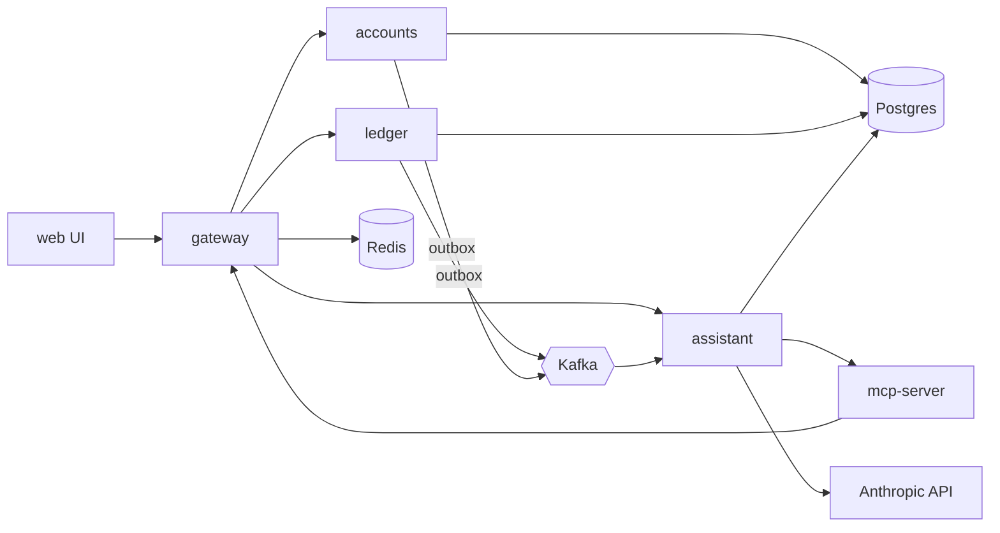

# 000 Architecture

Status: draft. All data is synthetic. Runs locally via Docker Compose.

## 1. Goals and non-goals

Goals
- Learn Rust (axum, sqlx, tokio), Kafka, Redis, Postgres, vector search and AI by building a small but realistic bank.
- Correct money handling: double-entry ledger, idempotent writes, no lost events.
- Everything starts with `docker compose up`.

Non-goals
- Real money, real PII, real payment rails, KYC, regulatory compliance.
- Cloud deployment, Kubernetes, multi-region.
- Production-grade security (local dev only).

## 2. Component view



## 3. Services

All services are Rust (edition 2021+), `axum` for HTTP, `sqlx` for Postgres, `tokio` runtime, `tracing` for logs.

| Service | Responsibility | Owned data |
|---|---|---|
| accounts | Customers, accounts, account status. Read balances by asking the ledger. | schema `accounts`: `customers`, `accounts`, `outbox` |
| ledger | Source of truth for money. Transfers, double-entry postings, balances, idempotency. Publishes events via outbox. | schema `ledger`: `transfers`, `entries`, `balances`, `idempotency_keys`, `outbox` |
| gateway | Single public API (BFF). Auth, rate limiting, request routing, serves the REST API to UI and MCP. | Redis only (sessions, rate limits) |
| assistant | RAG question answering and the agent loop. Calls Anthropic. Owns embeddings and chat history. | schema `assistant`: `documents`, `embeddings` (pgvector), `conversations`, `approvals` |
| mcp-server | Exposes banking API as MCP tools. Thin adapter over gateway; no data. | none |
| web UI | Browser app: login, accounts, transactions, transfer form, assistant chat, approval prompts. Rust + Leptos (or static HTML + htmx; see open questions). | none |

Rules
- A service only writes to its own schema. Cross-service reads go through HTTP or Kafka events, never SQL joins across schemas.
- Money amounts are integer minor units (`i64`) plus currency code. No floats.

## 4. Data stores

Postgres (one instance, one database, one schema per service, one DB role per schema)
- Migrations via `sqlx migrate`, kept per service.
- Ledger invariants enforced in DB: `sum(entries.amount) = 0` per transfer (checked in transaction and by a periodic audit query), entries are append-only (no UPDATE/DELETE grants).

Vector store
- Start with `pgvector` in the `assistant` schema (HNSW index, cosine).
- Optional later: Qdrant behind a `VectorStore` trait to compare. Switch by config.

Redis uses
- Sessions: `session:{id}` with TTL.
- Cache: balance and recent-transactions reads, `cache:balance:{account_id}`, short TTL, invalidated by ledger events.
- Rate limits: token bucket per user and per IP at the gateway.
- Idempotency keys: fast-path lookup `idem:{key}` at the gateway (SET NX with TTL). Ledger Postgres table is the durable source of truth.

## 5. Kafka

Single broker (KRaft mode, no ZooKeeper) locally.

| Topic | Producer | Consumers | Key | Purpose |
|---|---|---|---|---|
| `ledger.transfers.v1` | ledger (outbox relay) | assistant (embedder), cache invalidator | `account_id` of source account | Transfer posted / failed |
| `accounts.events.v1` | accounts (outbox relay) | assistant | `account_id` | Account opened / closed / updated |
| `assistant.audit.v1` | assistant | none initially (log sink) | `conversation_id` | Agent tool calls and approvals |
| `*.dlq.v1` | consumers | manual | original key | Poison messages |

Event envelope (JSON, schema versioned in topic name and `schema_version` field):
```json
{ "event_id": "uuid", "type": "TransferPosted", "occurred_at": "RFC3339",
  "schema_version": 1, "aggregate_id": "transfer uuid", "payload": { } }
```
`TransferPosted` payload: `transfer_id, from_account, to_account, amount_minor, currency, memo, posted_at`.

Delivery semantics
- Producers: at-least-once, `acks=all`, idempotent producer enabled.
- Consumers: at-least-once with manual offset commit after processing; handlers are idempotent via `event_id` dedup table.
- Ordering: guaranteed per partition key (per account). No global ordering.
- 3 partitions per topic locally.

Outbox pattern (ledger, same for accounts)
1. In the same Postgres transaction as the transfer, insert a row into `ledger.outbox` (`id, topic, key, payload, created_at, published_at`).
2. A relay task in the service polls unpublished rows (`FOR UPDATE SKIP LOCKED`), publishes to Kafka, then sets `published_at`.
3. Crash between publish and mark causes a duplicate, which consumers tolerate via `event_id`.

## 6. Key flows

Create transfer (double-entry + idempotency)
1. UI sends `POST /transfers` with header `Idempotency-Key` to the gateway.
2. Gateway authenticates, rate limits, checks `idem:{key}` in Redis (phase 2; before that skips this step), forwards to ledger.
3. Ledger in one DB transaction: look up `idempotency_keys` (same key and same request hash returns the stored response; same key with different body returns 422); lock both account balance rows in id order; check funds and account status; insert `transfers` row, two `entries` (debit source, credit destination), update `balances`; store idempotency record with response; insert outbox row.
4. Commit, return `201` with the transfer. Relay publishes `TransferPosted`.

RAG question
1. UI sends question to gateway then assistant.
2. Assistant embeds the question, runs vector search filtered by `customer_id`, builds a prompt with retrieved transaction snippets as clearly delimited data, calls Claude, returns answer with cited transaction ids.
3. Embedding pipeline (background): consume `ledger.transfers.v1`, build a text document per transaction, embed, upsert into `embeddings` (keyed by `transfer_id`, so replays are idempotent).

Agent tool call with human approval
1. User asks "Send 50 to Alice for dinner".
2. Agent (Claude with tool use) calls read tools (`list_accounts`, `search_transactions`) freely.
3. For a write tool (`create_transfer`) the assistant does not execute. It stores a pending row in `approvals` with the exact arguments and returns an approval request to the UI.
4. User clicks approve; assistant executes the tool via gateway with a fresh idempotency key stored on the approval row. Reject marks it rejected. Result goes back to the model. All steps are published to `assistant.audit.v1`.

Seed dummy data
- `cargo run -p seed` (or `docker compose run seed`) calls the public API (not SQL) to create N customers, accounts, and M random transfers with a fixed RNG seed for repeatability. Uses the faker crate. Idempotent: re-running with the same seed makes no duplicates.
- Flags: `--customers`, `--accounts-per-customer`, `--transfers`, `--seed`.

## 7. AI design

Models: Anthropic Claude via the Messages API (key in `ANTHROPIC_API_KEY`). A fast, cheap model for RAG answers, a stronger one for the agent; configurable by env var. Embeddings: Anthropic does not offer an embeddings model, so use a hosted embedding provider (e.g. Voyage AI) or a local model via the `fastembed` crate. Decision in open questions; hidden behind an `Embedder` trait.

Embedding pipeline: Kafka consumer in assistant, batch of up to 64 events or 2s, embed, upsert. Backfill command re-embeds from the ledger API.

RAG: top-k (default 8) cosine search, always filtered by the authenticated customer. Prompt separates instructions from retrieved data. Answer must cite transaction ids; if retrieval is empty, say so.

Agent tools (defined once, shared by assistant and mcp-server):
- Read: `list_accounts`, `get_balance`, `search_transactions`, `get_transfer`.
- Write (approval required): `create_transfer`.
- Max 8 tool-call steps per turn, per-turn token budget.

MCP server: Rust, streamable HTTP transport. Exposes the same tools, each calling the gateway with the caller's token. Lets external MCP clients (e.g. Claude Desktop) use the bank.

Guardrails
- Tool calls run with the end user's identity; the model never sees or sets customer ids it was not given.
- Server-side validation of every tool argument; amount caps per transfer and per day.
- Write tools always need human approval; approvals are bound to exact arguments and expire in 5 minutes.
- Output filter: no account numbers other than the user's own.

Prompt-injection notes
- Transaction memos are user-controlled text and therefore untrusted. They enter prompts only inside delimited data blocks, with a system instruction to treat them as data.
- Injection must not be able to cause money movement: the approval step shows the real arguments from the server, not model prose.
- Retrieval is scoped by customer so one user's memo cannot reach another's prompt.
- Keep a small test set of malicious memos ("ignore previous instructions...") in the eval suite.

## 8. Auth

- Local-only. Login with email and password (argon2 hashes) against `accounts.customers`; gateway issues an opaque session id in an HttpOnly cookie, stored in Redis (phase 1 uses a Postgres `sessions` table in `accounts`, moved to Redis in phase 2).
- Gateway passes `X-Customer-Id` (signed internal JWT) to internal services. Internal services are not published on host ports except for debugging.
- Authorization: a customer can only access their own accounts; enforced in each service, not only the gateway.
- MCP: bearer token (a session token or a personal access token created in the UI).
- Seed users share a known dev password, printed by the seed script.

## 9. Observability

- Tracing: `tracing` + `tracing-opentelemetry`, OTLP to an OpenTelemetry collector then Tempo (or Jaeger). Trace context propagated in HTTP headers and Kafka headers (`traceparent`).
- Metrics: `metrics` crate with Prometheus exporter on `/metrics` in each service. Key metrics: request rate/latency/errors, transfers posted, outbox lag, consumer lag, LLM latency and token counts, cache hit rate.
- Dashboards: Grafana provisioned from files in `deploy/grafana/`.
- Logs: JSON to stdout, `docker compose logs`.
- Phases 1-4 start with logs only; Prometheus/Grafana arrive in phase 5 (basic `/metrics` can come earlier).

## 10. Docker Compose layout

| Container | Image / build | Host port | Volume |
|---|---|---|---|
| web | build `crates/web` | 8080 | none |
| gateway | build `crates/gateway` | 3000 | none |
| accounts | build `crates/accounts` | internal 3001 | none |
| ledger | build `crates/ledger` | internal 3002 | none |
| assistant | build `crates/assistant` | internal 3003 | none |
| mcp-server | build `crates/mcp-server` | 3100 | none |
| postgres | `pgvector/pgvector:pg16` | 5432 | `pgdata` |
| redis | `redis:7` | 6379 | `redisdata` |
| kafka | `apache/kafka` (KRaft) | 9092 | `kafkadata` |
| kafka-ui (optional) | `provectuslabs/kafka-ui` | 8081 | none |
| qdrant (optional, phase 3) | `qdrant/qdrant` | 6333 | `qdrantdata` |
| seed | build `crates/seed`, profile `tools` | none | none |
| prometheus, grafana, otel-collector (phase 5) | official images | 9090, 3030, 4317 | `grafanadata` |

- Compose profiles: default (phase 1 set), `kafka`, `ai`, `observability`, `tools`.
- Config via `.env` (example in `.env.example`); no secrets committed.
- Rust builds use a shared cargo-chef Dockerfile to keep rebuilds fast.

## 11. Repo layout (Cargo workspace)

```
mock-bank/
  Cargo.toml              # workspace
  crates/
    common/               # money type, errors, event envelope, auth claims, tracing setup
    accounts/
    ledger/
    gateway/
    assistant/
    mcp-server/
    web/
    seed/
  migrations/             # per-service subfolders
  deploy/                 # compose files, grafana, prometheus, otel config
  specs/                  # one spec per feature, 000 is this file
  knowledge/              # repo knowledge (OKF)
  docker-compose.yml
  .env.example
```

## 12. Phases

Phase 1: core bank (task 001)
- Services: accounts, ledger, gateway, web UI, Postgres, seed script.
- Acceptance:
  - `docker compose up` starts everything; migrations run automatically.
  - `docker compose run seed` creates customers, accounts and transfers.
  - Logging in as a seed user shows accounts, balances and transaction list in the UI.
  - A transfer made in the UI updates both balances; retrying with the same idempotency key does not duplicate it.
  - Overdraft is rejected. DB-level check shows all transfers sum to zero.
  - Unit and integration tests (testcontainers) pass in CI.

Phase 2: Kafka and Redis (task 002)
- Outbox relay, `ledger.transfers.v1`, consumer with dedup, Redis sessions/cache/rate limit/idempotency.
- Acceptance:
  - Every posted transfer appears on the topic exactly once per outbox row (duplicates tolerated, none lost) even if the relay is killed mid-run.
  - Killing and restarting a consumer resumes without reprocessing side effects.
  - Exceeding the rate limit returns `429`; cached balance reads show a hit-rate metric/log.
  - Failing messages land in the DLQ.

Phase 3: RAG and vector DB (task 003)
- Assistant service, embedding pipeline, pgvector, chat UI.
- Acceptance:
  - Newly seeded transfers become searchable within 10 s.
  - "How much did I spend on groceries last month?" style questions return an answer citing transaction ids.
  - A user never gets another user's data in answers (test).
  - Qdrant swap (optional) works by config with the same tests.

Phase 4: agent and MCP (task 004)
- Agent loop, tools, approvals, MCP server, audit topic.
- Acceptance:
  - Agent can answer read questions using tools.
  - A transfer request produces a pending approval; nothing moves until approved; rejected requests do nothing.
  - MCP server works from an external MCP client and uses the same tools.
  - Injection test set (malicious memos) does not trigger a transfer.

Phase 5: load tests and observability (task 005)
- k6 (or `goose`) load scripts, Prometheus, Grafana, tracing.
- Acceptance:
  - Load test of transfers (target 200 req/s locally, p95 < 200 ms, to be tuned) with no ledger invariant violations afterwards.
  - Grafana dashboards show request, outbox lag, consumer lag and LLM metrics.
  - One trace spans UI request, gateway, ledger, Kafka and consumer.

## 13. Open questions

1. Web UI: Leptos (all Rust) vs htmx + server-rendered templates (askama)? Leaning htmx for speed in phase 1.
2. Embeddings provider: Voyage AI vs local `fastembed`? Local avoids another key.
3. Internal service calls: REST/JSON only, or gRPC (tonic) between services for learning?
4. Event format: JSON or Avro/Protobuf with a schema registry?
5. Should accounts and ledger be one service in phase 1 to reduce overhead, then split?
6. Multi-currency and FX: out of scope for now; confirm.
7. Which Claude models for RAG vs agent (decide at phase 3 based on cost).
