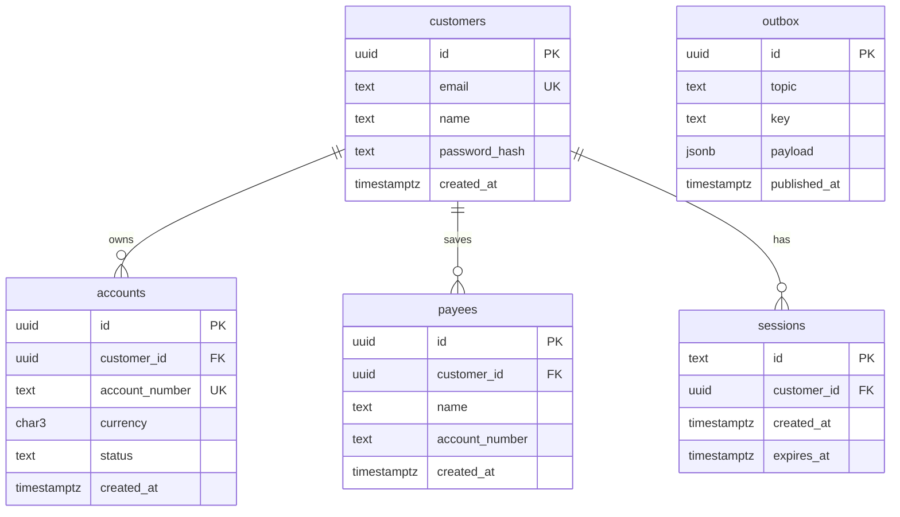

# Accounts DB Schema

Status: draft

## Goal
Full Postgres DDL, grants and migration conventions for schema `accounts`.

## Scope (in)
- Tables: `customers`, `accounts`, `payees`, `sessions`, `outbox`.
- Constraints, indexes, grants per DB role.
- Migration naming.

## Out of scope
- Balances and ledger data (`ledger/002-schema`).
- Redis sessions (phase 2; `sessions` table is replaced then).

## Design
**Migrations**: `migrations/accounts/NNNN_description.sql` (4-digit zero-padded, increasing; never edited after merge). Phase 1: `0001_init.sql` (all below), `0002_grants.sql`. Run by `accounts_owner` at service start.

**Roles**: `accounts_owner` owns the schema and all objects (migrations only). `accounts_svc` is the runtime role.


`outbox` has no foreign keys by design (it is an event log written in the same transaction).

**DDL** (`0001_init.sql`)
```sql
CREATE SCHEMA IF NOT EXISTS accounts AUTHORIZATION accounts_owner;
SET search_path = accounts;

CREATE TABLE customers (
  id            uuid PRIMARY KEY DEFAULT gen_random_uuid(),
  email         text        NOT NULL,
  name          text        NOT NULL,
  password_hash text        NOT NULL,           -- argon2 PHC string
  created_at    timestamptz NOT NULL DEFAULT now(),
  CONSTRAINT customers_email_uk UNIQUE (email),
  CONSTRAINT customers_email_lower CHECK (email = lower(email))
);

CREATE TABLE accounts (
  id             uuid PRIMARY KEY DEFAULT gen_random_uuid(),
  customer_id    uuid        NOT NULL REFERENCES customers(id),
  account_number text        NOT NULL,          -- 12 digits, Luhn
  currency       char(3)     NOT NULL,
  status         text        NOT NULL DEFAULT 'open',
  created_at     timestamptz NOT NULL DEFAULT now(),
  closed_at      timestamptz,
  CONSTRAINT accounts_number_uk UNIQUE (account_number),
  CONSTRAINT accounts_number_fmt CHECK (account_number ~ '^[0-9]{12}$'),
  CONSTRAINT accounts_currency_fmt CHECK (currency ~ '^[A-Z]{3}$'),
  CONSTRAINT accounts_status_chk CHECK (status IN ('open','closed')),
  CONSTRAINT accounts_closed_at_chk CHECK ((status = 'closed') = (closed_at IS NOT NULL))
);
CREATE INDEX accounts_customer_idx ON accounts (customer_id);

CREATE TABLE payees (
  id             uuid PRIMARY KEY DEFAULT gen_random_uuid(),
  customer_id    uuid        NOT NULL REFERENCES customers(id) ON DELETE CASCADE,
  name           text        NOT NULL,
  account_number text        NOT NULL,
  created_at     timestamptz NOT NULL DEFAULT now(),
  CONSTRAINT payees_customer_number_uk UNIQUE (customer_id, account_number),
  CONSTRAINT payees_number_fmt CHECK (account_number ~ '^[0-9]{12}$')
);

CREATE TABLE sessions (
  id          text        PRIMARY KEY,          -- 256-bit random, base64url
  customer_id uuid        NOT NULL REFERENCES customers(id) ON DELETE CASCADE,
  created_at  timestamptz NOT NULL DEFAULT now(),
  expires_at  timestamptz NOT NULL,
  CONSTRAINT sessions_expiry_chk CHECK (expires_at > created_at)
);
CREATE INDEX sessions_customer_idx ON sessions (customer_id);
CREATE INDEX sessions_expires_idx  ON sessions (expires_at);

-- standard outbox from common/005-outbox
CREATE TABLE outbox (
  id           uuid PRIMARY KEY DEFAULT gen_random_uuid(),
  topic        text        NOT NULL,
  key          text        NOT NULL,
  payload      jsonb       NOT NULL,
  created_at   timestamptz NOT NULL DEFAULT now(),
  published_at timestamptz,
  attempts     integer     NOT NULL DEFAULT 0,
  last_error   text
);
CREATE INDEX outbox_unpublished_idx ON outbox (created_at) WHERE published_at IS NULL;
```
Notes
- Accounts are never deleted; closing sets `status='closed'` and `closed_at`. Only `open` to `closed` is allowed (enforced in the service).
- Expired sessions are treated as missing on read and removed by a periodic `DELETE ... WHERE expires_at < now()`.
- No treasury or system accounts exist here; they exist only in `ledger` (see `ledger/002-schema`).
- Payee `account_number` is not a foreign key: it may refer to an account of another customer, and no cross-customer lookup is exposed.

**Grants** (`0002_grants.sql`)
```sql
REVOKE ALL ON SCHEMA accounts FROM PUBLIC;
GRANT USAGE ON SCHEMA accounts TO accounts_svc;
GRANT SELECT, INSERT, UPDATE         ON accounts  TO accounts_svc;   -- no DELETE
GRANT SELECT, INSERT                 ON customers TO accounts_svc;   -- no UPDATE/DELETE in phase 1
GRANT SELECT, INSERT, DELETE         ON payees, sessions TO accounts_svc;
GRANT SELECT, INSERT, UPDATE         ON outbox    TO accounts_svc;   -- relay marks published
-- no TRUNCATE, no DDL, no access to other schemas
```

## Dependencies
- `platform/002-workspace-and-compose` (roles and schema bootstrap), `common/005-outbox` (outbox DDL).

## Acceptance criteria
- [ ] Migrations apply cleanly on an empty database as `accounts_owner`.
- [ ] Duplicate email, account number, or `(customer_id, account_number)` payee is rejected by the DB.
- [ ] Invalid currency, status, or account number format is rejected by CHECK.
- [ ] `accounts_svc` cannot DELETE from `accounts` or `customers`, run DDL, or touch schema `ledger`.
- [ ] Outbox partial index exists.

## Test plan
- Integration (testcontainers Postgres): apply migrations; attempt each violating insert; connect as `accounts_svc` and assert denied statements.
