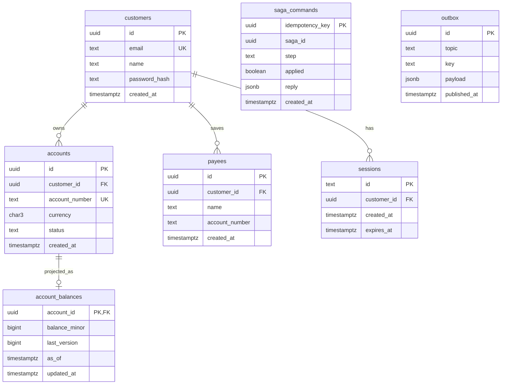

# Accounts DB Schema

Status: draft

## Goal
Full Postgres DDL, grants and migration conventions for schema `accounts`.

## Scope (in)
- Tables: `customers`, `accounts`, `payees`, `sessions`, `outbox`, `account_balances` (read-only projection of ledger balances), `processed_events`, `saga_commands` (saga command dedupe).
- Constraints, indexes, grants per DB role.
- Migration naming.

## Out of scope
- Authoritative balances and ledger data (`ledger/002-schema`); `account_balances` is a derived copy only.
- Redis sessions (phase 2; `sessions` table is replaced then).

## Design
**Migrations**: `migrations/accounts/NNNN_description.sql` (4-digit zero-padded, increasing; never edited after merge). Phase 1: `0001_init.sql` (all below, including `account_balances`, `processed_events` and `saga_commands`), `0002_grants.sql`. Run by `accounts_owner` at service start.

**Roles**: `accounts_owner` owns the schema and all objects (migrations only). `accounts_svc` is the runtime role.


`outbox` and `saga_commands` have no foreign keys by design (`outbox` is an event log written in the same transaction; `saga_commands` ids come from the transfers saga, other schema).

**DDL** (`0001_init.sql`)
```sql
CREATE SCHEMA IF NOT EXISTS accounts AUTHORIZATION accounts_owner;
SET search_path = accounts;

CREATE TABLE customers (
  id            uuid PRIMARY KEY DEFAULT gen_random_uuid(),
  email         text        NOT NULL,
  name          text        NOT NULL,
  password_hash text        NOT NULL,           -- argon2 PHC string
  created_at    timestamptz NOT NULL DEFAULT now(),
  CONSTRAINT customers_email_uk UNIQUE (email),
  CONSTRAINT customers_email_lower CHECK (email = lower(email))
);

CREATE TABLE accounts (
  id             uuid PRIMARY KEY DEFAULT gen_random_uuid(),
  customer_id    uuid        NOT NULL REFERENCES customers(id),
  account_number text        NOT NULL,          -- 12 digits, Luhn
  currency       char(3)     NOT NULL,
  status         text        NOT NULL DEFAULT 'open',
  created_at     timestamptz NOT NULL DEFAULT now(),
  closed_at      timestamptz,
  CONSTRAINT accounts_number_uk UNIQUE (account_number),
  CONSTRAINT accounts_number_fmt CHECK (account_number ~ '^[0-9]{12}$'),
  CONSTRAINT accounts_currency_fmt CHECK (currency ~ '^[A-Z]{3}$'),
  CONSTRAINT accounts_status_chk CHECK (status IN ('open','closed')),
  CONSTRAINT accounts_closed_at_chk CHECK ((status = 'closed') = (closed_at IS NOT NULL))
);
CREATE INDEX accounts_customer_idx ON accounts (customer_id);

CREATE TABLE payees (
  id             uuid PRIMARY KEY DEFAULT gen_random_uuid(),
  customer_id    uuid        NOT NULL REFERENCES customers(id) ON DELETE CASCADE,
  name           text        NOT NULL,
  account_number text        NOT NULL,
  created_at     timestamptz NOT NULL DEFAULT now(),
  CONSTRAINT payees_customer_number_uk UNIQUE (customer_id, account_number),
  CONSTRAINT payees_number_fmt CHECK (account_number ~ '^[0-9]{12}$')
);

CREATE TABLE sessions (
  id          text        PRIMARY KEY,          -- 256-bit random, base64url
  customer_id uuid        NOT NULL REFERENCES customers(id) ON DELETE CASCADE,
  created_at  timestamptz NOT NULL DEFAULT now(),
  expires_at  timestamptz NOT NULL,
  CONSTRAINT sessions_expiry_chk CHECK (expires_at > created_at)
);
CREATE INDEX sessions_customer_idx ON sessions (customer_id);
CREATE INDEX sessions_expires_idx  ON sessions (expires_at);

-- read-only projection of ledger balances, written only by the ledger.postings.v1 consumer
CREATE TABLE account_balances (
  account_id    uuid PRIMARY KEY REFERENCES accounts(id),
  balance_minor bigint      NOT NULL,
  last_version  bigint      NOT NULL,           -- ledger per-account balance version
  as_of         timestamptz NOT NULL,           -- posted_at of the last applied posting
  updated_at    timestamptz NOT NULL DEFAULT now()
);

-- dedup table for common/004-events-kafka consumers
CREATE TABLE processed_events (
  event_id     uuid        NOT NULL,
  consumer     text        NOT NULL,
  processed_at timestamptz NOT NULL DEFAULT now(),
  PRIMARY KEY (event_id, consumer)
);

-- saga command dedupe (accounts/001-service, common/006-saga): one row per handled command, written in the same transaction as the ledger result
CREATE TABLE saga_commands (
  idempotency_key uuid        PRIMARY KEY,        -- UUIDv5(saga_id, step), from the command; an undo has step '{step}:undo'
  saga_id         uuid        NOT NULL,
  step            text        NOT NULL,           -- step name from the command, e.g. 'debit' or 'debit:undo'
  applied         boolean     NOT NULL,           -- false: undo ('debit:undo') for a never-applied debit, or a debit rejected as compensated (no posting made)
  reply           jsonb       NOT NULL,           -- {saga_id, step, result, code}, re-sent verbatim on a seen key
  created_at      timestamptz NOT NULL DEFAULT now()
);
CREATE INDEX saga_commands_saga_idx ON saga_commands (saga_id, step);

-- standard outbox from common/005-outbox
CREATE TABLE outbox (
  id           uuid PRIMARY KEY DEFAULT gen_random_uuid(),
  topic        text        NOT NULL,
  key          text        NOT NULL,
  payload      jsonb       NOT NULL,
  created_at   timestamptz NOT NULL DEFAULT now(),
  published_at timestamptz,
  attempts     integer     NOT NULL DEFAULT 0,
  last_error   text
);
CREATE INDEX outbox_unpublished_idx ON outbox (created_at) WHERE published_at IS NULL;
```
Notes
- Accounts are never deleted; closing sets `status='closed'` and `closed_at`. Only `open` to `closed` is allowed (enforced in the service).
- Expired sessions are treated as missing on read and removed by a periodic `DELETE ... WHERE expires_at < now()`.
- No treasury or system accounts exist here; they exist only in `ledger` (see `ledger/002-schema`).
- `account_balances` rows are created on the first posting for an account (no row means balance 0, `as_of` null). The ledger enforces non-negative balances; this table stores what the ledger said. Rows are upserted only when `last_version` increases.
- `saga_commands`: a seen `idempotency_key` re-sends `reply` and applies nothing. The undo marker is the undo row itself, whose `step` is `<debit step>:undo` (`debit:undo`): a `debit` is rejected (`failed`, `compensated`) when `EXISTS (SELECT 1 FROM saga_commands WHERE saga_id = $1 AND step = $2 || ':undo')` with `$2` the debit step. There is no `cmd` column; the step name identifies the command. A `debit:undo` with no earlier `debit` row is inserted with `applied = false`, reply `ok`, and makes no posting. A rejected late `debit` is inserted with `applied = false` and its `failed` reply. The service takes `pg_advisory_xact_lock(hashtext(saga_id::text))` before the check so a debit and its undo for one saga serialize. Rows are never updated or deleted in phase 1.
- Payee `account_number` is not a foreign key: it may refer to an account of another customer, and no cross-customer lookup is exposed.

**Grants** (`0002_grants.sql`)
```sql
REVOKE ALL ON SCHEMA accounts FROM PUBLIC;
GRANT USAGE ON SCHEMA accounts TO accounts_svc;
GRANT SELECT, INSERT, UPDATE         ON accounts  TO accounts_svc;   -- no DELETE
GRANT SELECT, INSERT                 ON customers TO accounts_svc;   -- no UPDATE/DELETE in phase 1
GRANT SELECT, INSERT, DELETE         ON payees, sessions TO accounts_svc;
GRANT SELECT, INSERT, UPDATE         ON outbox    TO accounts_svc;   -- relay marks published
GRANT SELECT, INSERT, UPDATE         ON account_balances TO accounts_svc;  -- written by the consumer module only
GRANT SELECT, INSERT                 ON processed_events TO accounts_svc;
GRANT SELECT, INSERT                 ON saga_commands    TO accounts_svc;   -- append-only dedupe record
-- no TRUNCATE, no DDL, no access to other schemas
```

## Dependencies
- `platform/002-workspace-and-compose` (roles and schema bootstrap), `common/005-outbox` (outbox DDL).

## Acceptance criteria
- [ ] Migrations apply cleanly on an empty database as `accounts_owner`.
- [ ] Duplicate email, account number, or `(customer_id, account_number)` payee is rejected by the DB.
- [ ] Invalid currency, status, or account number format is rejected by CHECK.
- [ ] `accounts_svc` cannot DELETE from `accounts` or `customers`, run DDL, or touch schema `ledger`.
- [ ] Outbox partial index exists.
- [ ] `account_balances.account_id` must reference an existing account; duplicate `(event_id, consumer)` in `processed_events` is rejected.
- [ ] An upsert with a lower or equal `last_version` leaves the row unchanged.
- [ ] A second `saga_commands` insert with the same `idempotency_key` is rejected.
- [ ] `accounts_svc` cannot UPDATE or DELETE `saga_commands`.
- [ ] After a row with `step = 'debit:undo'` exists for a `saga_id`, the late-debit lookup finds it (via `saga_commands_saga_idx`), so a `debit` for that saga is rejected.
- [ ] A `debit:undo` with no prior `debit` row is stored with `applied = false` and an `ok` reply.

## Test plan
- Integration (testcontainers Postgres): apply migrations; attempt each violating insert; connect as `accounts_svc` and assert denied statements.
