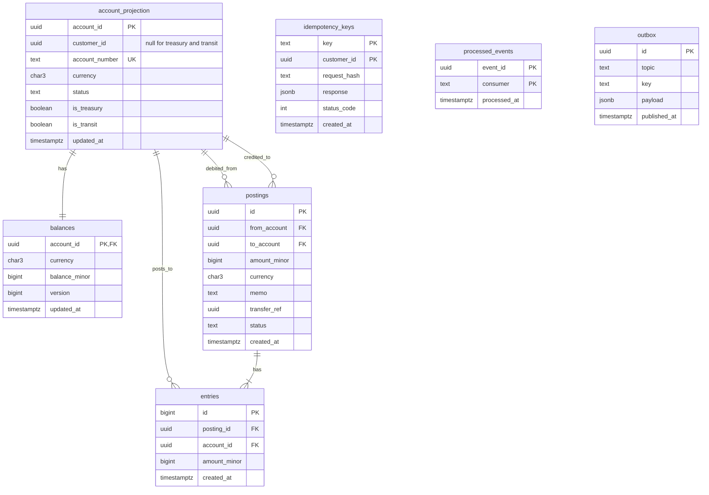

# Ledger DB Schema

Status: draft

Note: the ledger holds postings only. The user-facing transfer workflow and its state live in the transfers service (`transfers/002-schema`).

## Goal
Full Postgres DDL, grants and invariant enforcement for schema `ledger`.

## Scope (in)
- Tables: `account_projection`, `balances`, `postings`, `entries`, `idempotency_keys`, `processed_events`, `outbox`.
- Constraints, indexes, grants per DB role, append-only entries, zero-sum enforcement, treasury and transit accounts.
- Migration naming.

## Out of scope
- Customers, payees, sessions (`accounts/002-schema`).
- FX and cross-currency.

## Design
**Migrations**: `migrations/ledger/NNNN_description.sql` (4-digit zero-padded, increasing; never edited after merge). Phase 1: `0001_init.sql` (tables), `0002_invariants.sql` (triggers), `0003_system_accounts.sql` (treasury and transit system-account rows), `0004_grants.sql`. Run by `ledger_owner` at service start.

**Roles**: `ledger_owner` owns the schema and objects (migrations only). `ledger_svc` is the runtime role.


`idempotency_keys.customer_id` holds the caller's customer id (the nil UUID for admin calls without a customer). `processed_events` and `outbox` are standalone.

**DDL** (`0001_init.sql`)
```sql
CREATE SCHEMA IF NOT EXISTS ledger AUTHORIZATION ledger_owner;
SET search_path = ledger;

CREATE TABLE account_projection (
  account_id     uuid PRIMARY KEY,               -- same id as accounts.accounts.id (or generated for treasury/transit)
  customer_id    uuid,                           -- NULL only for treasury and transit
  account_number text        NOT NULL,           -- 12 digits, 'bank:treasury:<CUR>' or 'bank:transit:<CUR>'
  currency       char(3)     NOT NULL,
  status         text        NOT NULL DEFAULT 'open',
  is_treasury    boolean     NOT NULL DEFAULT false,
  is_transit     boolean     NOT NULL DEFAULT false,   -- in-flight funds between a transfer's debit and credit
  updated_at     timestamptz NOT NULL DEFAULT now(),
  CONSTRAINT proj_number_uk UNIQUE (account_number),
  CONSTRAINT proj_currency_fmt CHECK (currency ~ '^[A-Z]{3}$'),
  CONSTRAINT proj_status_chk CHECK (status IN ('open','closed')),
  CONSTRAINT proj_system_chk CHECK (
    (is_treasury AND NOT is_transit AND customer_id IS NULL AND account_number = 'bank:treasury:' || currency)
    OR (is_transit AND NOT is_treasury AND customer_id IS NULL AND account_number = 'bank:transit:' || currency)
    OR (NOT is_treasury AND NOT is_transit AND customer_id IS NOT NULL AND account_number ~ '^[0-9]{12}$'))
);
CREATE INDEX proj_customer_idx ON account_projection (customer_id);

CREATE TABLE balances (
  account_id    uuid PRIMARY KEY REFERENCES account_projection(account_id),
  currency      char(3) NOT NULL,
  balance_minor bigint  NOT NULL DEFAULT 0,
  version       bigint  NOT NULL DEFAULT 0,   -- +1 on each posting touching the row, same transaction; published as from_version/to_version
  updated_at    timestamptz NOT NULL DEFAULT now()
);
-- Overdraft guard: only treasury may be negative; transit is never negative (a debit always precedes its credit). Enforced in the DB via trigger in 0002.

CREATE TABLE postings (
  id           uuid PRIMARY KEY,
  from_account uuid        NOT NULL REFERENCES account_projection(account_id),
  to_account   uuid        NOT NULL REFERENCES account_projection(account_id),
  amount_minor bigint      NOT NULL,
  currency     char(3)     NOT NULL,
  memo         text        NOT NULL DEFAULT '',
  transfer_ref uuid,                             -- opaque id of the transfers-service transfer; no FK (other schema)
  status       text        NOT NULL DEFAULT 'posted',
  created_at   timestamptz NOT NULL DEFAULT now(),
  CONSTRAINT postings_amount_pos CHECK (amount_minor > 0),
  CONSTRAINT postings_distinct CHECK (from_account <> to_account),
  CONSTRAINT postings_status_chk CHECK (status IN ('posted')),
  CONSTRAINT postings_memo_len CHECK (char_length(memo) <= 140)
);
CREATE INDEX postings_from_idx ON postings (from_account, created_at DESC, id DESC);
CREATE INDEX postings_to_idx   ON postings (to_account,   created_at DESC, id DESC);

CREATE TABLE entries (
  id           bigint GENERATED ALWAYS AS IDENTITY PRIMARY KEY,
  posting_id  uuid        NOT NULL REFERENCES postings(id),
  account_id   uuid        NOT NULL REFERENCES account_projection(account_id),
  amount_minor bigint      NOT NULL,             -- signed: debit negative, credit positive
  created_at   timestamptz NOT NULL DEFAULT now(),
  CONSTRAINT entries_nonzero CHECK (amount_minor <> 0),
  CONSTRAINT entries_one_per_account UNIQUE (posting_id, account_id)
);
CREATE INDEX entries_account_idx ON entries (account_id, id DESC);

CREATE TABLE idempotency_keys (
  key          text        NOT NULL,
  customer_id  uuid        NOT NULL,
  request_hash text        NOT NULL,             -- sha256 hex of canonical request
  response     jsonb       NOT NULL,
  status_code  integer     NOT NULL,
  created_at   timestamptz NOT NULL DEFAULT now(),
  PRIMARY KEY (key, customer_id)
);

CREATE TABLE processed_events (                  -- used by common/events consumer
  event_id     uuid        NOT NULL,
  consumer     text        NOT NULL,
  processed_at timestamptz NOT NULL DEFAULT now(),
  PRIMARY KEY (event_id, consumer)
);

-- standard outbox from common/005-outbox
CREATE TABLE outbox (
  id           uuid PRIMARY KEY DEFAULT gen_random_uuid(),
  topic        text        NOT NULL,
  key          text        NOT NULL,
  payload      jsonb       NOT NULL,
  created_at   timestamptz NOT NULL DEFAULT now(),
  published_at timestamptz,
  attempts     integer     NOT NULL DEFAULT 0,
  last_error   text
);
CREATE INDEX outbox_unpublished_idx ON outbox (created_at) WHERE published_at IS NULL;
```

**Invariants** (`0002_invariants.sql`)
1. Append-only entries and postings:
```sql
CREATE FUNCTION forbid_mutation() RETURNS trigger LANGUAGE plpgsql AS
$$ BEGIN RAISE EXCEPTION '% on % is not allowed (append-only)', TG_OP, TG_TABLE_NAME; END $$;
CREATE TRIGGER entries_append_only   BEFORE UPDATE OR DELETE ON entries   FOR EACH ROW EXECUTE FUNCTION forbid_mutation();
CREATE TRIGGER postings_append_only BEFORE UPDATE OR DELETE ON postings FOR EACH ROW EXECUTE FUNCTION forbid_mutation();
CREATE TRIGGER entries_no_truncate   BEFORE TRUNCATE ON entries   FOR EACH STATEMENT EXECUTE FUNCTION forbid_mutation();
CREATE TRIGGER postings_no_truncate BEFORE TRUNCATE ON postings FOR EACH STATEMENT EXECUTE FUNCTION forbid_mutation();
```
Defence in depth: the grants (below) also give `ledger_svc` no UPDATE/DELETE/TRUNCATE on these tables, and `ledger_svc` is not the owner, so it cannot drop the triggers.

2. Zero-sum per posting: a deferred constraint trigger checks at commit.
```sql
CREATE FUNCTION check_posting_zero_sum() RETURNS trigger LANGUAGE plpgsql AS $$
DECLARE s bigint; n integer;
BEGIN
  SELECT coalesce(sum(amount_minor),0), count(*) INTO s, n FROM entries WHERE posting_id = NEW.posting_id;
  IF s <> 0 OR n <> 2 THEN
    RAISE EXCEPTION 'posting % must have exactly 2 entries summing to 0 (sum=%, n=%)', NEW.posting_id, s, n;
  END IF;
  RETURN NULL;
END $$;
CREATE CONSTRAINT TRIGGER entries_zero_sum AFTER INSERT ON entries
  DEFERRABLE INITIALLY DEFERRED FOR EACH ROW EXECUTE FUNCTION check_posting_zero_sum();
```
Entries for a posting are inserted in the same transaction as the posting, so the check runs at commit and sees both rows. Entry currency matching the posting is enforced by the service; the audit view re-checks it.

3. Overdraft guard: only treasury may go negative.
```sql
CREATE FUNCTION check_balance_nonneg() RETURNS trigger LANGUAGE plpgsql AS $$
BEGIN
  IF NEW.balance_minor < 0 AND NOT (SELECT is_treasury FROM account_projection WHERE account_id = NEW.account_id) THEN
    RAISE EXCEPTION 'insufficient_funds for account %', NEW.account_id;
  END IF;
  RETURN NEW;
END $$;
CREATE TRIGGER balances_nonneg BEFORE INSERT OR UPDATE ON balances FOR EACH ROW EXECUTE FUNCTION check_balance_nonneg();
```
The service checks funds first and returns `422 insufficient_funds`; the trigger is the backstop.

4. Audit views (read-only, used by tests and a periodic audit):
```sql
CREATE VIEW audit_zero_sum_violations AS
  SELECT t.id FROM postings t LEFT JOIN entries e ON e.posting_id = t.id
  GROUP BY t.id HAVING coalesce(sum(e.amount_minor),0) <> 0 OR count(e.id) <> 2;
CREATE VIEW audit_balance_mismatches AS
  SELECT b.account_id FROM balances b
  LEFT JOIN (SELECT account_id, sum(amount_minor) s FROM entries GROUP BY account_id) x USING (account_id)
  WHERE b.balance_minor <> coalesce(x.s,0);
```
Both must return zero rows.

**Treasury accounts** (`0003_system_accounts.sql`): inserted by migration, not by events.
```sql
INSERT INTO account_projection (account_id, customer_id, account_number, currency, is_treasury)
SELECT gen_random_uuid(), NULL, 'bank:treasury:' || c, c, true FROM unnest(ARRAY['USD','EUR','GBP']) AS c
ON CONFLICT (account_number) DO NOTHING;
INSERT INTO account_projection (account_id, customer_id, account_number, currency, is_transit)
SELECT gen_random_uuid(), NULL, 'bank:transit:' || c, c, true FROM unnest(ARRAY['USD','EUR','GBP']) AS c
ON CONFLICT (account_number) DO NOTHING;
INSERT INTO balances (account_id, currency) SELECT account_id, currency FROM account_projection WHERE is_treasury OR is_transit
ON CONFLICT DO NOTHING;
```
`bank:transit:<CUR>` holds funds between a transfer's debit posting (customer to transit) and credit posting (transit to destination), and receives the undo of a reversed debit. Its balance is zero when no transfer is in flight (checked by a periodic audit). Treasury and transit have no counterpart in the accounts service and never appears in `accounts.events.v1`. Rebuilding the projection (truncate non-treasury rows, replay) must keep `is_treasury` and `is_transit` rows. Origination from a treasury source requires `initiator_role = admin` on the posting request, checked in the service.

**Projection replay**: `account_projection` and `balances` rows for non-treasury accounts are created by the `AccountOpened` handler (`INSERT ... ON CONFLICT (account_id) DO UPDATE` for projection; `balances ... ON CONFLICT DO NOTHING` so balances derived from entries survive a projection replay). A projection reset therefore only deletes projection rows that have no entries, or replays with upsert only; it never deletes `entries`.

**Grants** (`0004_grants.sql`)
```sql
REVOKE ALL ON SCHEMA ledger FROM PUBLIC;
GRANT USAGE ON SCHEMA ledger TO ledger_svc;
GRANT SELECT, INSERT, UPDATE ON account_projection, balances, outbox TO ledger_svc;
GRANT SELECT, INSERT         ON postings, entries, idempotency_keys   TO ledger_svc;  -- append-only
GRANT SELECT, INSERT         ON processed_events                      TO ledger_svc;
GRANT DELETE                 ON processed_events                      TO ledger_svc;  -- consumer reset helper
GRANT USAGE ON SEQUENCE entries_id_seq TO ledger_svc;
GRANT SELECT ON audit_zero_sum_violations, audit_balance_mismatches   TO ledger_svc;
-- no DELETE/TRUNCATE on entries, postings; no DDL; no access to schema accounts
```

## Dependencies
- `platform/002-workspace-and-compose` (roles), `common/005-outbox` (outbox DDL), `common/004-events-kafka` (`processed_events` shape).

## Acceptance criteria
- [ ] Migrations apply on an empty database as `ledger_owner`; treasury and transit rows exist for each configured currency.
- [ ] `UPDATE`/`DELETE`/`TRUNCATE` on `entries` and `postings` fail for `ledger_svc` (privilege) and for the owner (trigger).
- [ ] Committing a posting whose entries do not sum to zero, or are not exactly two, fails at commit.
- [ ] A negative balance on a non-treasury account is rejected; treasury may go negative.
- [ ] Both audit views return zero rows after a mixed workload.
- [ ] `balances.version` equals the number of entries on the account and rises by exactly 1 per posting.
- [ ] Duplicate `(key, customer_id)` idempotency insert is rejected; duplicate `(event_id, consumer)` is rejected.
- [ ] `ledger_svc` cannot access schema `accounts` or run DDL.

## Test plan
- Integration (testcontainers Postgres): apply migrations; attempt each violating statement as `ledger_svc` and as `ledger_owner`; property-style test inserting random valid postings then asserting the audit views are empty.
