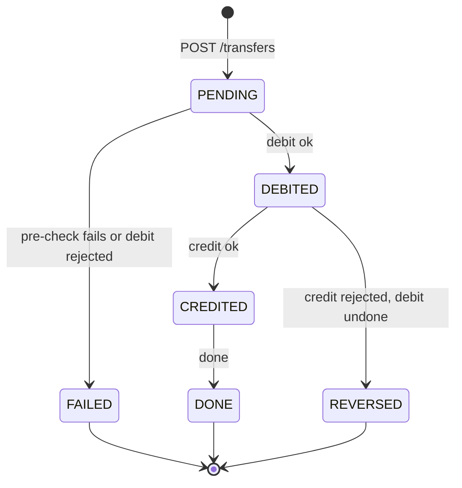

# Transfers Service

Status: draft

## Goal
Own the customer-facing transfer workflow. Accept a transfer fast (`202`), queue it on Kafka, run it as the first saga type on the generic saga runner (`common/006-saga`) against accounts (pre-check) and ledger (debit, credit, undo), and publish the result. The ledger only does double-entry postings (`ledger/001-service`).

Trade-off: the client no longer gets an instant success or failure. `POST /transfers` only says "accepted"; the final result arrives by polling or SSE, and the UI shows "processing" until then. In return, bursts are absorbed by a bounded queue, per-account order is kept, and the ledger sees a steady, ordered load.

## Scope (in)
- Crate `services/transfers` (axum, sqlx, tokio), internal port 3004. Schema `transfers` (`transfers/002-schema`).
- `POST /transfers` with idempotency; writes the transfer row (`PENDING`) and the command outbox row in one transaction.
- Outbox relay to topic `transfers.commands.v1` (`common/005-outbox`), key = source account id.
- Transfer workers: consumers of `transfers.commands.v1` running the `transfer` saga type (step list `debit`, `credit`, `done`) on `common/006-saga`.
- The `transfer` step implementations, idempotent ledger calls, undo of the debit, link between the `transfers` row and its `sagas` row.
- Results: `GET /transfers/{id}`, SSE `GET /transfers/{id}/events`, history `GET /accounts/{id}/transfers`.
- `transfer.*` events on `transfers.events.v1` via outbox.
- Admission control / backpressure (below).

## Out of scope
- Double-entry, balances, overdraft enforcement (ledger).
- Customers, accounts, payees (accounts).
- Rate limiting per user/IP and public auth (gateway).
- FX, cross-currency, scheduled or recurring transfers.
- Cross-shard transfers (`platform/003-scale-and-portability`, P4).

## Design

**Endpoints** (internal; JWT with `X-Customer-Id`; called only by the gateway)
- `POST /transfers` header `Idempotency-Key` (required, else 400), body `{from_account_id, to_account_number, amount_minor, currency, memo}` -> `202 {transfer_id, status: "PENDING"}` and `Location: /transfers/{id}`.
  - Body is validated syntactically (amount > 0, memo <= 140, currency format) -> `400`/`422`. No call to other services on this path.
  - Same `(customer, key)` + same request hash -> `202` with the same `transfer_id` and its current status (no second transfer, no second command). Same key + different body -> `422 idempotency_conflict`.
  - Over the backlog limits -> `503 overloaded` or `429 too_many_in_flight` with `Retry-After` (Admission control).
- `GET /transfers/{id}` -> `200 {id, status, state, from_account_id, to_account_number, amount_minor, currency, memo, failure_code?, failure_message?, created_at, updated_at}`. `state` is `processing` (`PENDING`, `DEBITED`, `CREDITED`) or final (`done`, `failed`, `reversed`). Owner or admin; else `404`.
- `GET /transfers/{id}/events` -> `text/event-stream`. First event is the current state (read from the DB, so nothing is missed), then one SSE event per `transfer.*` event for that transfer; the stream closes after a final state. Heartbeat comment every 15 s; max stream age 5 min (the client reconnects and gets the current state again).
- `GET /accounts/{id}/transfers?limit=&before=` -> `200 [{id, direction, counterparty, amount_minor, currency, memo, state, created_at}]` (owner only; includes in-flight transfers with their `state`).

**Request flow**
1. Gateway authenticates, rate limits, and calls `POST /transfers`.
2. In one transaction: insert `transfers` row (`PENDING`, `request_hash`), insert the `sagas` row (`type = transfer`, `saga_id = transfer_id`, `IN_PROGRESS`), insert the command outbox row (topic `transfers.commands.v1`, key = `from_account_id`, envelope type `TransferRequested`, payload `{transfer_id}`) and the event outbox row `transfer.created`. Commit, return `202`.
3. The relay publishes the command. Kafka is the buffer and the per-account ordering mechanism: same key = same partition = processed one after another; different accounts run in parallel across partitions.
4. A worker consumes the command (group `transfers-workers`) and runs the saga with the runner (lock the `sagas` row, run the step, save, repeat) to a final state, then commits the offset last. Worker concurrency is at most the partition count. The handler is idempotent: it loads the row and continues from its saved `current_step`.

**Saga** (the first saga type on the generic runner `common/006-saga`; the runner owns the loop, retries, undo order and crash recovery)

The transfer is a saga of type `transfer` with three steps. The `sagas` row (`saga_id = transfer_id`) holds the progress; the `transfers` row holds the business fields and a mirror `status` for queries, updated in the same transaction by the runner's per-step hook, which also enqueues the `transfer.*` event.

| Step | Action | Undo | Key |
|---|---|---|---|
| `debit` | pre-check (below), then ledger `POST /postings` customer account -> `bank:transit:<CUR>`; `initiator_role` copied from the row | ledger posting transit -> original source | `{transfer_id}-debit` / `{transfer_id}-debit-undo` |
| `credit` | ledger `POST /postings` `bank:transit:<CUR>` -> destination | none | `{transfer_id}-credit` |
| `done` | finalize, emit `transfer.completed` | none | n/a |

`credit` and `done` cannot be undone and come last, after the only undoable step (rule in `common/006-saga`). If `credit` is rejected the debit is undone; once `credit` succeeds only `done` is left, which cannot fail on business grounds.

`transfers.status` mirrors the saga: `PENDING` (no step done), `DEBITED`, `CREDITED`, then `DONE` / `FAILED` / `REVERSED` (the saga's final status). While the saga's `failure_reason` is set the transfer stays `DEBITED` until the undo finishes. There is no separate compensation state.

Step details
1. **Pre-check** (first part of `debit`, advisory, fast): accounts `GET /accounts/{id}` as the customer (source must be owned and open) and `GET /accounts/resolve?account_number=` (destination exists, open, same currency, not the source). Stores the resolved `to_account` id in the saga payload and the `transfers` row. A failure is a permanent failure with nothing done -> `FAILED` with `failure_code` (`account_not_found`, `account_closed`, `currency_mismatch`, `same_account`). Ownership is the only mandatory part: the ledger does not check customer ownership for postings from the `service` role. Funds and status are rechecked authoritatively by the ledger, so a stale pre-check does no harm. If accounts stays unreachable after the retries the transfer fails with `unavailable`.
2. **Debit**: `422 insufficient_funds` (the authoritative overdraft check) or another business rejection -> `FAILED`; nothing to undo.
3. **Credit**: business rejection (`account_closed`, `currency_mismatch`) -> the runner sets `failure_reason` and runs the undo of `debit`: ledger posting transit -> original source, key `{transfer_id}-debit-undo`, then `REVERSED` (emits `transfer.reversed`). Reversal is a new posting, never a delete (ledger entries are append-only).
4. **Done**: `CREDITED` -> `DONE`, emits `transfer.completed`.

Failure handling and crash recovery are those of `common/006-saga`, with these transfer values
- Transient errors (timeout, `5xx`, `409 account_not_ready`) retry with the same key; `SAGA_MAX_ATTEMPTS` (default 5, about 30 s). After that a forward step counts as a business failure: in `debit` -> `FAILED` (`unavailable`); in `credit` -> undo runs.
- The undo retries without limit (backoff capped at 30 s) and holds its partition, since money is in transit. It raises `transfers_reversal_stuck`.
- A repeated ledger call with the same key is a replay (`ledger/001`: same key + same body returns the stored response), so a debit is never applied twice, at any of the 3 crash points.
- The sweeper re-enqueues `transfer` sagas that stay `IN_PROGRESS` with a stale `updated_at` onto `transfers.commands.v1`.
- Poison commands (saga or transfer row missing or corrupt) go to `transfers.commands.dlq.v1`.

**Idempotency keys**
- Client key: `Idempotency-Key` per customer, stored on the transfer row.
- Ledger keys from the runner: `{saga_id}-{step}` with `saga_id = transfer_id` (`debit`, `credit`) and `{transfer_id}-{step}-undo` (`debit-undo`).

**Events** (topic `transfers.events.v1`, key = source `account_id`, envelope from `common/004-events-kafka`, written via outbox in the same transaction as the state change)
- Types: `transfer.created`, `transfer.debited`, `transfer.completed`, `transfer.failed`, `transfer.reversed`.
- Payload `{transfer_id, status, from_account, to_account, amount_minor, currency, memo, failure_code?, occurred_at}`.
- Consumers: SSE fan-out inside each transfers instance (own consumer group per instance, start at latest, no stored offsets), assistant embedder (`transfer.completed` only), cache invalidator.

**Admission control and backpressure**
Layers, outermost first
1. Gateway: Redis token bucket per user and per IP -> `429` with `Retry-After` (`gateway/001-service`, `platform/003-scale-and-portability`).
2. Transfers admission, checked before the insert on `POST /transfers`:
   - global backlog (count of non-final transfers: `PENDING`, `DEBITED`, `CREDITED`) above `TRANSFERS_MAX_BACKLOG` (default 10000) -> `503 overloaded`;
   - consumer lag of group `transfers-workers` on `transfers.commands.v1` above `TRANSFERS_MAX_LAG` (default 5000), sampled every second -> `503 overloaded`;
   - per-customer in-flight above `TRANSFERS_MAX_PER_CUSTOMER` (default 50) -> `429 too_many_in_flight`.
   `Retry-After` is in seconds, estimated from backlog / recent completion rate (minimum 1). Nothing is written when rejected, so retrying with the same key is safe.
3. Workers drain at the pace of the ledger; a slow ledger grows lag, which trips layer 2 instead of overloading the ledger.

Metrics: backlog, consumer lag, transfers/s by final state, saga step latency, time from `PENDING` to final, rejected-by-admission count, reversal-stuck gauge.

**Auth**: workers call accounts and ledger with a JWT minted by the transfers service (`iss = transfers`): the customer-role token of the original `customer_id` for the ownership pre-check, and `role = service` for ledger calls (`common/002-auth-claims`). Admin-initiated transfers (fund from treasury, bulk) are stored with `initiator_role = admin`; a treasury source is only accepted for admin, and the ledger re-enforces it.

**Config**: `PORT`, `DATABASE_URL`, `KAFKA_BROKERS`, `ACCOUNTS_URL`, `LEDGER_URL`, `JWT_SECRET`, `TRANSFERS_MAX_BACKLOG`, `TRANSFERS_MAX_PER_CUSTOMER`, `TRANSFERS_MAX_LAG`, `SAGA_MAX_ATTEMPTS`. Timeouts on every outbound call (`platform/003`, R4).

## Dependencies
- `transfers/002-schema`, `common/006-saga`, `accounts/001-service` (pre-check endpoints), `ledger/001-service` (postings), `common/001-money-and-errors`, `common/002-auth-claims`, `common/003-telemetry`, `common/004-events-kafka`, `common/005-outbox`.

## Acceptance criteria
- [ ] `POST /transfers` returns `202` with a `transfer_id` and writes the transfer row and outbox rows in one transaction (a rollback leaves none).
- [ ] Missing `Idempotency-Key` returns 400. Same key + same body returns the same `transfer_id` and creates one transfer and one command; different body returns 422.
- [ ] The command is published to `transfers.commands.v1` with key = source account id.
- [ ] Transfers from one source account are processed in submission order; transfers from different accounts run in parallel.
- [ ] A successful transfer ends `DONE`; ledger balances change by exactly the amount; transit balance returns to zero.
- [ ] Overdraft ends `FAILED` with `insufficient_funds` and no change to balances.
- [ ] Not owning the source account ends `FAILED` and the ledger is never called.
- [ ] Credit rejection (destination closed after the pre-check) ends `REVERSED`: the source balance is restored by the `{transfer_id}-debit-undo` posting.
- [ ] Killing a worker after the debit and before the credit, then restarting, ends `DONE` with one debit and one credit posting; the same holds for a crash at each of the 3 crash points of `common/006-saga`.
- [ ] A transfer saga left `IN_PROGRESS` with a stale `updated_at` is re-enqueued by the sweeper and finishes.
- [ ] Creating a transfer writes the `transfers` row, the `sagas` row and the outbox rows in one transaction.
- [ ] Every ledger call uses key `{transfer_id}-{step}` or `{transfer_id}-{step}-undo`.
- [ ] `GET /transfers/{id}` returns the current state; another customer's transfer is 404.
- [ ] SSE `GET /transfers/{id}/events` sends the current state first, then each `transfer.*` event, and closes after a final state.
- [ ] Over the backlog, lag or per-customer limit, `POST /transfers` returns `503`/`429` with `Retry-After` and writes nothing.
- [ ] Every state change publishes its `transfer.*` event at least once (duplicates tolerated by `event_id`, none lost).
- [ ] Service writes only to schema `transfers`.

## Test plan
- Unit: transfer step logic, status mirror transitions (allowed and forbidden), request hashing, `Retry-After` estimate.
- Integration (testcontainers Postgres + Kafka, accounts and ledger stubbed with wiremock): happy path, each failure path, crash-resume (abort the worker at each of the 3 crash points of every step via a fault hook), per-account ordering with interleaved keys, admission limits, SSE stream, outbox relay restart.
- End-to-end (compose): real ledger; invariants and transit-zero audit after a concurrent load.
