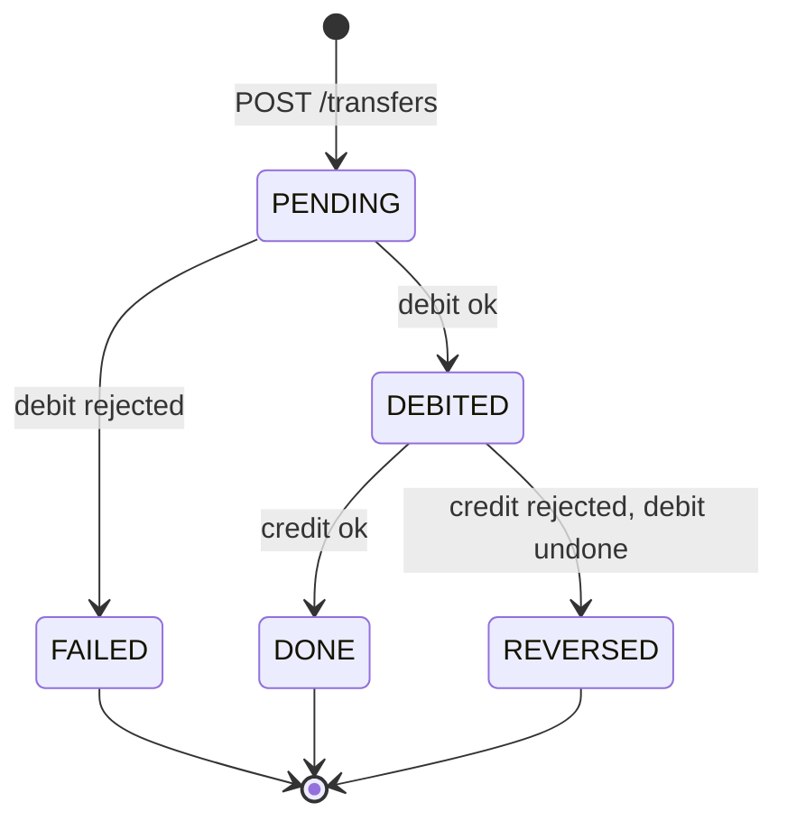

# Transfers Service

Status: draft

## Goal
Own the customer-facing transfer workflow. Accept a transfer fast (`202`), run it as the first saga type on the generic saga orchestrator (`common/006-saga`) by sending debit and credit commands to accounts over Kafka (`accounts.commands` / `accounts.replies`), and publish the result. Accounts executes the postings (through the ledger, `ledger/001-service`); transfers never calls accounts or the ledger synchronously to move money.

Trade-off: the client no longer gets an instant success or failure. `POST /transfers` only says "accepted"; the final result arrives by polling or SSE, and the UI shows "processing" until then. In return, bursts are absorbed by Kafka, no HTTP call is held open on the money path, and a crash anywhere is recovered by redelivery and the sweeper.

## Scope (in)
- Crate `services/transfers` (axum, sqlx, tokio), internal port 3004. Schema `transfers` (`transfers/002-schema`).
- `POST /transfers` with idempotency; the start transaction writes the transfer row (`PENDING`), the saga row, the first step and the first command in one transaction.
- Outbox relay to `accounts.commands` (key = `saga_id`) and to `transfers.events.v1` (`common/005-outbox`).
- Reply consumer on `accounts.replies` (group `transfers-orchestrator`) running the `transfer` saga type (step list `debit`, `credit`) on `common/006-saga`.
- The `transfer` step definitions, undo of the debit, link between the `transfers` row and its `sagas` row.
- Results: `GET /transfers/{id}`, SSE `GET /transfers/{id}/events`, history `GET /accounts/{id}/transfers`.
- `transfer.*` events on `transfers.events.v1` via outbox.
- Admission control / backpressure (below).

## Out of scope
- Double-entry, balances, overdraft enforcement (ledger, applied by accounts when it handles the command).
- Customers, accounts, payees (accounts), including the accounts-side command consumer and its dedupe.
- Rate limiting per user/IP and public auth (gateway).
- FX, cross-currency, scheduled or recurring transfers.
- Cross-shard transfers (`platform/003-scale-and-portability`, P4).

## Design

**Endpoints** (internal; JWT with `X-Customer-Id`; called only by the gateway)
- `POST /transfers` header `Idempotency-Key` (required, else 400), body `{from_account_id, to_account_number, amount_minor, currency, memo}` -> `202 {transfer_id, status: "PENDING"}` and `Location: /transfers/{id}`. `transfer_id` is the `saga_id`.
  - Body is validated syntactically (amount > 0, memo <= 140, currency format) -> `400`/`422`. The only calls to another service on this path are the read-only accounts lookups below (source ownership, destination resolve, advisory balance). No money-moving call is made here.
  - Same `(customer, key)` + same request hash -> `202` with the same `transfer_id` and its current status (no second transfer, no second command). Same key + different body -> `422 idempotency_conflict`.
  - **Lookups before the start transaction** (after the idempotency lookup and admission), as the customer, timeout 200 ms each: accounts `GET /accounts/{from_account_id}` (owned and open, plus `balance_minor` and `as_of` from the balance projection) and `GET /accounts/resolve?account_number=` (destination exists, open, same currency, not the source). The resolved destination id is stored in the saga `context` and the `transfers` row because the credit command needs it. Not owned -> `404`; destination or currency problems -> `422` (`account_not_found`, `account_closed`, `currency_mismatch`, `same_account`); nothing is written. If accounts is unreachable these lookups fail the request with `503` (no money moved, safe to retry with the same key).
  - **Balance pre-check (advisory, early fast-fail)**: for customer-initiated transfers only. If `balance_minor < amount_minor` return `422 insufficient_funds` `{error, message, balance_minor, as_of}` and write nothing: no `transfers` row, no `sagas` row, no outbox rows, no command. If the balance read is slow, errors or `as_of` is null, skip only this check and admit (fail-open; accounts/ledger is the authority). Admin and treasury-funded transfers skip it. A client retry with the same key after a reject is evaluated again, so it can pass once the projection catches up.
  - Staleness consequences: the projection trails the ledger. False pass (projection shows funds that are already spent): the transfer is admitted and ends `FAILED` (`insufficient_funds`) at the debit command, which is authoritative. False reject (projection misses a recent credit or reversal): the customer gets `422` although the ledger would allow it; the reject body carries `as_of` so the UI can say the balance may be out of date, and a retry shortly after succeeds. Never a wrong debit: accounts/ledger decides.
  - Over the backlog limits -> `503 overloaded` or `429 too_many_in_flight` with `Retry-After` (Admission control).
- `GET /transfers/{id}` -> `200 {id, status, state, from_account_id, to_account_number, amount_minor, currency, memo, failure_code?, failure_message?, created_at, updated_at}`. `state` is `processing` (`PENDING`, `DEBITED`) or final (`done`, `failed`, `reversed`). Owner or admin; else `404`.
- `GET /transfers/{id}/events` -> `text/event-stream`. First event is the current state (read from the DB, so nothing is missed), then one SSE event per `transfer.*` event for that transfer; the stream closes after a final state. Heartbeat comment every 15 s; max stream age 5 min (the client reconnects and gets the current state again).
- `GET /accounts/{id}/transfers?limit=&before=` -> `200 [{id, direction, counterparty, amount_minor, currency, memo, state, created_at}]` (owner only; includes in-flight transfers with their `state`).

**Request flow** (debit-then-credit: the source is debited first)
1. Gateway authenticates, rate limits, and calls `POST /transfers`.
2. Start transaction (`common/006-saga`), one commit: insert `transfers` row (`PENDING`, `request_hash`, `to_account`); insert `sagas` (`type = transfer`, `saga_id = transfer_id`, `RUNNING`, `current_step = debit`, `context = {from_account, to_account, amount_minor, currency, initiator_role}`, `deadline = now() + SAGA_STEP_TIMEOUT`); insert `saga_steps` (`debit`, `started`); insert the command outbox row (topic `accounts.commands`, key = `saga_id`, payload `{saga_id, step: "debit", cmd: "debit", account: from_account, amount, idempotency_key}`); insert the event outbox row `transfer.created`. Commit, return `202`.
3. The relay publishes the command (unsent rows are those with `published_at IS NULL`). Accounts consumes it, dedupes by `idempotency_key`, performs the debit, publishes the reply to `accounts.replies`, and only then acks the command.
4. The reply consumer (group `transfers-orchestrator`, key = `saga_id`) handles each reply in one transaction: lock the `sagas` row `FOR UPDATE`, drop the reply if its step is not the current step or is already done, else run the hook, append the `saga_steps` row, update `sagas`, and insert the next outbox row (`credit` command, or the undo). The offset is committed last. Concurrency is at most the partition count of `accounts.replies`.

Ordering note: commands are keyed by `saga_id`, so ordering between two transfers from the same source account is no longer guaranteed by Kafka. Overdraft safety does not depend on it (the ledger checks the balance at each debit); only the processing order of concurrent transfers varies.

**Saga** (the first saga type on the orchestrator `common/006-saga`; it owns the reply handler, retries, undo order, the sweeper and crash recovery)

The transfer is a saga of type `transfer` with two steps. The `sagas` row (`saga_id = transfer_id`) holds the progress; the `transfers` row holds the business fields and a mirror `status` for queries, updated in the same transaction by the step hook, which also enqueues the `transfer.*` event.

| Step | Command | Undo | Idempotency key |
|---|---|---|---|
| `debit` | `debit` `from_account` by `amount` (accounts moves the funds source -> `bank:transit:<CUR>` in the ledger) | `undo_debit` (transit -> original source), step name `debit:undo` | `UUIDv5(transfer_id, "debit")` / `UUIDv5(transfer_id, "debit:undo")` |
| `credit` | `credit` `to_account` by `amount` (transit -> destination) | none | `UUIDv5(transfer_id, "credit")` |

`credit` cannot be undone and comes last, after the only undoable step (rule in `common/006-saga`). If `credit` is rejected the debit is undone; the last step's `ok` reply ends the saga `COMPLETED` (no separate `done` step).

`transfers.status` mirrors the saga: `PENDING` (debit not done), `DEBITED`, then `DONE` (saga `COMPLETED`) / `FAILED` / `REVERSED` (the saga's final statuses). While the saga is `COMPENSATING` the transfer keeps its status (`DEBITED` after a credit rejection, `PENDING` after a debit timeout) until the undo finishes; a debit timeout ends saga `REVERSED` but transfer `FAILED` (`unavailable`). There is no separate compensation state.

Step details
1. **Debit**: reply `failed` with `insufficient_funds` (the authoritative overdraft check), `account_closed`, or another business rejection -> `on_failure` = `Compensate`, but nothing is done yet -> saga `FAILED`, transfer `FAILED` with `failure_code` = reply code. Success -> transfer `DEBITED`, emit `transfer.debited`, queue `credit`.
2. **Credit**: reply `failed` (`account_closed`, `currency_mismatch` after the lookups) -> the saga sets `failure_reason`, status `COMPENSATING`, queues `debit:undo` (transit -> original source, key `UUIDv5(transfer_id, "debit:undo")`); on its `ok` reply the saga is `REVERSED`, transfer `REVERSED`, emits `transfer.reversed`. Reversal is a new posting, never a delete (ledger entries are append-only). `ok` -> saga `COMPLETED`, transfer `DONE`, emits `transfer.completed`.

Failure handling and crash recovery are those of `common/006-saga`, with these transfer values
- No reply by the `deadline` (30 s default): the sweeper re-publishes the same command with the same key (accounts dedupes). The debit retries up to `SAGA_MAX_ATTEMPTS` (default 5); after that the debit is treated as failed (code `unavailable`) and, since its outcome is unknown, `debit:undo` runs (accounts reverses the debit only if it was applied and refuses a later debit of the same transfer, per the `common/006-saga` late-reply rule); the saga ends `REVERSED` and the transfer `FAILED` with `failure_code = unavailable`. A `credit` timeout never compensates: it is retried without limit with the same key, since the outcome is unknown and the credit may already be applied.
- The undo retries without limit (backoff capped at 30 s), since money is in transit. It raises `saga_undo_stuck`.
- A repeated command with the same key is a replay (accounts returns the stored reply), so a debit is never applied twice, at any crash point of the table in `common/006-saga`.
- The sweeper re-publishes `RUNNING`/`COMPENSATING` `transfer` sagas whose step is stale or past its `deadline`. Late replies after a timeout or compensation are checked against the saga state and dropped unless they match the current step.
- Each step is recorded in the append-only `saga_steps` table (`common/006-saga`); the history of a transfer is `SELECT * FROM saga_steps WHERE saga_id = $transfer_id ORDER BY ts`.
- Poison replies (saga or transfer row missing or corrupt) go to `accounts.replies.dlq`.

**Idempotency keys**
- Client key: `Idempotency-Key` per customer, stored on the transfer row.
- Command keys from the orchestrator: `UUIDv5(namespace = saga_id, name = step)` with `saga_id = transfer_id` (`debit`, `credit`) and name `debit:undo` for the undo. Deterministic, so every re-send carries the same key.

**Events** (topic `transfers.events.v1`, key = source `account_id`, envelope from `common/004-events-kafka`, written via outbox in the same transaction as the state change)
- Types: `transfer.created`, `transfer.debited`, `transfer.completed`, `transfer.failed`, `transfer.reversed`.
- Payload `{transfer_id, status, from_account, to_account, amount_minor, currency, memo, failure_code?, occurred_at}`.
- Consumers: SSE fan-out inside each transfers instance (own consumer group per instance, start at latest, no stored offsets), assistant embedder (`transfer.completed` only), cache invalidator.

**Admission control and backpressure**
Layers, outermost first
1. Gateway: Redis token bucket per user and per IP -> `429` with `Retry-After` (`gateway/001-service`, `platform/003-scale-and-portability`).
2. Transfers admission, checked before the insert on `POST /transfers`:
   - global backlog (count of non-final transfers: `PENDING`, `DEBITED`) above `TRANSFERS_MAX_BACKLOG` (default 10000) -> `503 overloaded`;
   - consumer lag of group `transfers-orchestrator` on `accounts.replies`, or unsent outbox rows (`published_at IS NULL`), above `TRANSFERS_MAX_LAG` (default 5000), sampled every second -> `503 overloaded`;
   - per-customer in-flight above `TRANSFERS_MAX_PER_CUSTOMER` (default 50) -> `429 too_many_in_flight`.
   `Retry-After` is in seconds, estimated from backlog / recent completion rate (minimum 1). Nothing is written when rejected, so retrying with the same key is safe.
3. Accounts drains commands at the pace of the ledger; a slow ledger delays replies and grows backlog, which trips layer 2 instead of overloading the ledger.

Metrics: backlog, reply lag, unsent outbox count, transfers/s by final state, saga step latency (command queued to reply), time from `PENDING` to final, rejected-by-admission count, step timeouts, `saga_undo_stuck` gauge.

**Auth**: the start-time lookups use the customer's token. Commands carry no token; the accounts service trusts the topic (Kafka ACL: only `transfers` may produce to `accounts.commands`) and applies commands as the `service` role. Admin-initiated transfers (fund from treasury, bulk) are stored with `initiator_role = admin` in the saga `context`; a treasury source is only accepted for admin, and the ledger re-enforces it (`common/002-auth-claims`).

**Config**: `PORT`, `DATABASE_URL`, `KAFKA_BROKERS`, `ACCOUNTS_URL`, `JWT_SECRET`, `TRANSFERS_MAX_BACKLOG`, `TRANSFERS_MAX_PER_CUSTOMER`, `TRANSFERS_MAX_LAG`, `SAGA_MAX_ATTEMPTS`, `SAGA_STEP_TIMEOUT`, `SAGA_STALE_AFTER`, `SAGA_SWEEP_INTERVAL`, `SAGA_UNDO_MAX_BACKOFF`. Timeouts on every outbound call (`platform/003`, R4). `LEDGER_URL` is no longer used.

## Worked example (transfer 100 from A to B)
Accounts `A = 00000000-0000-4000-8000-0000000000a1`, `B = 00000000-0000-4000-8000-0000000000b1`; `transfer_id = saga_id`.

**Happy path**, `transfer_id = 6f1c2a40-0000-4000-8000-000000000001`
1. `POST /transfers` -> `202 {"transfer_id":"6f1c2a40-0000-4000-8000-000000000001","status":"PENDING"}`. Start tx: `transfers` `PENDING`, `sagas` `RUNNING`/`current_step debit`, `saga_steps` `debit started`, outbox rows `transfer.created` and the command:
   `{"saga_id":"6f1c2a40-0000-4000-8000-000000000001","step":"debit","cmd":"debit","account":"00000000-0000-4000-8000-0000000000a1","amount":100,"idempotency_key":"59bd9d3d-f1a7-5162-902f-0138792ce901"}`
2. Accounts replies `{"saga_id":"6f1c2a40-0000-4000-8000-000000000001","step":"debit","result":"ok","code":null}`. Handler tx: `debit done`, transfer `DEBITED`, `transfer.debited`, `credit started`, `current_step credit`, command `{"saga_id":"…0001","step":"credit","cmd":"credit","account":"00000000-0000-4000-8000-0000000000b1","amount":100,"idempotency_key":"0cecbc72-c4bc-5ba5-9fc3-5568ebc9bf4b"}`.
3. Reply `{"saga_id":"…0001","step":"credit","result":"ok","code":null}`. Handler tx: `credit done`, saga `COMPLETED`, transfer `DONE`, `transfer.completed`.

**Credit rejected**, `transfer_id = 6f1c2a40-0000-4000-8000-000000000002`
1. Debit succeeds as above (keys: debit `2c0acf23-5500-55d3-ad94-eca3a7a29eb9`, credit `00417a0e-6a0b-5426-97a6-479fe0f19c03`).
2. Reply `{"saga_id":"6f1c2a40-0000-4000-8000-000000000002","step":"credit","result":"failed","code":"account_closed"}`. Handler tx: `credit failed`, saga `COMPENSATING`, `failure_reason account_closed`, `debit:undo started`, command `{"saga_id":"…0002","step":"debit:undo","cmd":"undo_debit","account":"00000000-0000-4000-8000-0000000000a1","amount":100,"idempotency_key":"15c540dd-baab-5df6-bef8-f7f3757acde7"}`. Transfer stays `DEBITED`.
3. Reply `{"saga_id":"…0002","step":"debit:undo","result":"ok","code":null}`. Handler tx: `debit:undo compensated`, saga `REVERSED`, transfer `REVERSED` (`failure_code account_closed`), `transfer.reversed`. A's balance is restored.

**Pod dies**, `transfer_id = 6f1c2a40-0000-4000-8000-000000000003` (debit key `48d586b7-421f-533b-ab30-e760e67085ca`, credit key `af978dd4-8242-58b4-ba1c-67e9896d5e19`)
1. The orchestrator pod is killed after accounts published the debit reply, before the reply offset was committed. A restarted pod gets the reply redelivered: if the first tx committed, step 3 of the handler drops it; if not, it is handled and `credit` is queued.
2. If the reply was lost, the saga sits `RUNNING` on `debit` until its `deadline`; the sweeper re-publishes the debit command with key `48d586b7-…`; accounts finds the key, re-sends the stored reply, and does not debit twice. The transfer reaches `DONE` with one debit and one credit.

## Dependencies
- `transfers/002-schema`, `common/006-saga`, `accounts/001-service` (read endpoints for the start lookups, plus the `accounts.commands` consumer and `accounts.replies` producer with key dedupe), `ledger/001-service` (postings, via accounts), `common/001-money-and-errors`, `common/002-auth-claims`, `common/003-telemetry`, `common/004-events-kafka`, `common/005-outbox`.

## Acceptance criteria
- [ ] `POST /transfers` returns `202` with a `transfer_id` and writes the `transfers` row, the `sagas` row, the first `saga_steps` row and the outbox rows (command and `transfer.created`) in one transaction (a rollback leaves none). No money-moving call happens in the request.
- [ ] Missing `Idempotency-Key` returns 400. Same key + same body returns the same `transfer_id` and creates one transfer and one command; different body returns 422.
- [ ] The command `{saga_id, step, cmd, account, amount, idempotency_key}` is published to `accounts.commands` with key = `saga_id`; the debit command is first and targets the source.
- [ ] The idempotency key of each command is `UUIDv5(transfer_id, step)` (undo: `UUIDv5(transfer_id, "debit:undo")`) and identical on every re-send.
- [ ] A successful transfer ends `DONE` (saga `COMPLETED`); ledger balances change by exactly the amount; transit balance returns to zero.
- [ ] Overdraft ends `FAILED` with `insufficient_funds` and no change to balances (when the projection did not catch it earlier).
- [ ] With the projection showing a balance below the amount, `POST /transfers` returns `422 insufficient_funds` with `as_of`, and no `transfers`, `sagas`, outbox row or command exists.
- [ ] With a stale projection that shows enough funds but the ledger balance is too low, the transfer is admitted and ends `FAILED` at the debit; the ledger decides.
- [ ] With a stale projection that shows too little right after a credit, the request is rejected `422` and the same request succeeds once the projection catches up (documented false reject).
- [ ] Balance read slow (over 200 ms), failing or `as_of` null: the balance pre-check is skipped and the transfer is admitted.
- [ ] An existing idempotency key returns the stored transfer even if the projection would now reject.
- [ ] Admin/treasury-initiated transfers do not run the balance pre-check.
- [ ] Not owning the source account returns `404` and writes nothing; the command is never sent.
- [ ] Credit rejection (destination closed after the lookups) ends `REVERSED`: the source balance is restored by the `debit:undo` command; the transfer stays `DEBITED` while `COMPENSATING`.
- [ ] A reply for a step that is not current or already done is dropped without writing.
- [ ] Killing the orchestrator pod after the debit reply and before the offset commit, then restarting, ends `DONE` with one debit and one credit effect; the same holds for each row of the crash table of `common/006-saga`.
- [ ] A lost reply: the sweeper re-publishes the same command (same key) after the `deadline` and the transfer finishes with no double effect.
- [ ] A debit with no reply after `SAGA_MAX_ATTEMPTS` runs `debit:undo`; the saga ends `REVERSED`, the transfer `FAILED` (`unavailable`), and balances are unchanged whether or not the debit was applied.
- [ ] A late `credit` reply after a timeout never triggers a compensation; a late debit reply after compensation started is dropped.
- [ ] The step history of a transfer is returned in order from `saga_steps` (including `debit:undo` `compensated` rows for a `REVERSED` one).
- [ ] Every log line and span for a transfer carries `saga_id` (= `transfer_id`).
- [ ] `GET /transfers/{id}` returns the current state; another customer's transfer is 404.
- [ ] SSE `GET /transfers/{id}/events` sends the current state first, then each `transfer.*` event, and closes after a final state.
- [ ] Over the backlog, lag or per-customer limit, `POST /transfers` returns `503`/`429` with `Retry-After` and writes nothing.
- [ ] Every state change publishes its `transfer.*` event at least once (duplicates tolerated by `event_id`, none lost).
- [ ] Service writes only to schema `transfers`.

## Test plan
- Unit: transfer step logic (commands, `on_success`/`on_failure`), key derivation vectors from the worked example, status mirror transitions (allowed and forbidden), request hashing, `Retry-After` estimate.
- Integration (testcontainers Postgres + Kafka, accounts replaced by a stub consumer that dedupes by key and can reply `ok`/`failed`/never): the three worked examples (happy path, credit rejected, pod dies), debit rejected, debit timeout exhausted, credit timeout retried without compensation, start-time lookups and balance pre-check (reject, stale pass, stale reject, fail-open, admin skip), ownership `404`, idempotency (`400`, replay, `422`), `GET` endpoints and step history, duplicate and late replies, sweeper retry on timeout, duplicate command from a relay crash, admission limits, SSE stream, outbox relay restart.
- End-to-end (compose): real accounts and ledger; invariants and transit-zero audit after a concurrent load.
