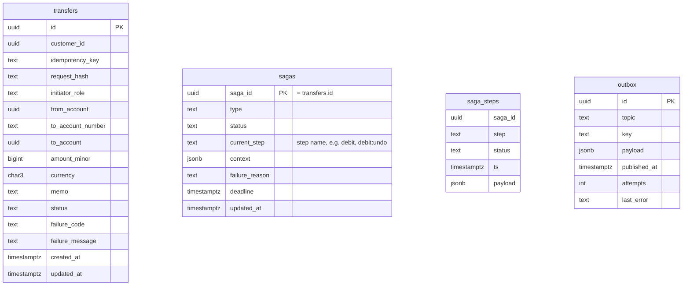

# Transfers DB Schema

Status: draft

## Goal
Postgres DDL, grants and constraints for schema `transfers`.

## Scope (in)
- Tables: `transfers`, `sagas` and `saga_steps` (standard DDL from `common/006-saga`), `outbox`.
- Constraints, indexes, grants per DB role, allowed status transitions.
- Migration naming.

## Out of scope
- Entries, balances, postings (`ledger/002-schema`).
- Customers, accounts (`accounts/002-schema`).

## Design
**Migrations**: `migrations/transfers/NNNN_description.sql` (4-digit zero-padded; never edited after merge). `0001_init.sql` (tables, transition trigger), `0002_grants.sql`. Run by the `transfers migrate` job as `transfers_owner` (`platform/002-workspace-and-compose`).

**Roles**: `transfers_owner` owns the schema (migrations only). `transfers_svc` is the runtime role; it has no privilege on schemas `accounts` or `ledger`.


`(customer_id, idempotency_key)` is unique. `from_account` and `to_account` are ids from the accounts service with no foreign key (other schema); `to_account` is set by the start-time destination lookup. `sagas.saga_id` equals `transfers.id` (inserted in the same transaction). `sagas` holds progress (`status`, `current_step`), `context`, `failure_reason` and the reply `deadline`; `transfers` holds business fields and a mirror `status`. `saga_steps` is the append-only step history of a saga (`saga_id` has no foreign key, rows are never updated or deleted). `outbox` is standalone; it holds the commands to `accounts.commands` (key = `saga_id`) and the `transfer.*` events; unsent rows are those with `published_at IS NULL`.

**DDL** (`0001_init.sql`)
```sql
CREATE SCHEMA IF NOT EXISTS transfers AUTHORIZATION transfers_owner;
SET search_path = transfers;

CREATE TABLE transfers (
  id                uuid PRIMARY KEY DEFAULT gen_random_uuid(),
  customer_id       uuid        NOT NULL,           -- nil UUID for admin calls without a customer
  idempotency_key   text        NOT NULL,
  request_hash      text        NOT NULL,           -- sha256 hex of canonical request
  initiator_role    text        NOT NULL,
  from_account      uuid        NOT NULL,
  to_account_number text        NOT NULL,
  to_account        uuid,                           -- set by the start-time destination lookup
  amount_minor      bigint      NOT NULL,
  currency          char(3)     NOT NULL,
  memo              text        NOT NULL DEFAULT '',
  status            text        NOT NULL DEFAULT 'PENDING',     -- mirror of the saga, set by the step hook
  failure_code      text,
  failure_message   text,
  created_at        timestamptz NOT NULL DEFAULT now(),
  updated_at        timestamptz NOT NULL DEFAULT now(),
  CONSTRAINT transfers_idem_uk UNIQUE (customer_id, idempotency_key),
  CONSTRAINT transfers_amount_pos CHECK (amount_minor > 0),
  CONSTRAINT transfers_memo_len CHECK (char_length(memo) <= 140),
  CONSTRAINT transfers_role_chk CHECK (initiator_role IN ('customer','admin')),
  CONSTRAINT transfers_status_chk CHECK (status IN
    ('PENDING','DEBITED','DONE','FAILED','REVERSED')),
  CONSTRAINT transfers_failure_chk CHECK (status NOT IN ('FAILED','REVERSED') OR failure_code IS NOT NULL)
);
CREATE INDEX transfers_inflight_idx ON transfers (created_at)
  WHERE status IN ('PENDING','DEBITED');   -- backlog count
CREATE INDEX transfers_customer_inflight_idx ON transfers (customer_id)
  WHERE status IN ('PENDING','DEBITED');   -- per-customer limit
CREATE INDEX transfers_from_idx ON transfers (from_account, created_at DESC, id DESC);
CREATE INDEX transfers_to_idx   ON transfers (to_account,   created_at DESC, id DESC) WHERE status = 'DONE';

-- standard saga state table from common/006-saga; saga_id = transfers.id (= the command key namespace)
CREATE TABLE sagas (
  saga_id        uuid        PRIMARY KEY,
  type           text        NOT NULL,
  status         text        NOT NULL DEFAULT 'RUNNING',
  current_step   text        NOT NULL,
  context        jsonb       NOT NULL,
  failure_reason text,
  deadline       timestamptz,
  updated_at     timestamptz NOT NULL DEFAULT now(),
  CONSTRAINT sagas_status_chk CHECK (status IN ('RUNNING','COMPENSATING','COMPLETED','REVERSED','FAILED'))
);
CREATE INDEX sagas_active_idx ON sagas (updated_at) WHERE status IN ('RUNNING','COMPENSATING');
CREATE INDEX sagas_deadline_idx ON sagas (deadline) WHERE deadline IS NOT NULL;

-- standard append-only step history from common/006-saga
CREATE TABLE saga_steps (
  saga_id uuid        NOT NULL,
  step    text        NOT NULL,
  status  text        NOT NULL,
  ts      timestamptz NOT NULL DEFAULT now(),
  payload jsonb,
  CONSTRAINT saga_steps_status_chk CHECK (status IN ('started','done','failed','compensated'))
);
CREATE INDEX saga_steps_saga_idx ON saga_steps (saga_id, ts);

-- standard outbox from common/005-outbox
CREATE TABLE outbox (
  id           uuid PRIMARY KEY DEFAULT gen_random_uuid(),
  topic        text        NOT NULL,
  key          text        NOT NULL,
  payload      jsonb       NOT NULL,
  created_at   timestamptz NOT NULL DEFAULT now(),
  published_at timestamptz,
  attempts     integer     NOT NULL DEFAULT 0,
  last_error   text
);
CREATE INDEX outbox_unpublished_idx ON outbox (created_at) WHERE published_at IS NULL;
```

**Allowed transitions** (trigger in `0001_init.sql`, also checked by the service)
```
PENDING   -> DEBITED | FAILED
DEBITED   -> DONE | REVERSED   (REVERSED only after the saga's failure_reason is set and the undo is done)
DONE, FAILED, REVERSED: final, rows are immutable
```
```sql
CREATE FUNCTION check_transfer_transition() RETURNS trigger LANGUAGE plpgsql AS $$
BEGIN
  IF OLD.status IN ('DONE','FAILED','REVERSED') THEN
    RAISE EXCEPTION 'transfer % is final (%)', OLD.id, OLD.status;
  END IF;
  IF NEW.status <> OLD.status AND (OLD.status, NEW.status) NOT IN (
      ('PENDING','DEBITED'),('PENDING','FAILED'),('DEBITED','DONE'),('DEBITED','REVERSED')) THEN
    RAISE EXCEPTION 'invalid transfer transition % -> %', OLD.status, NEW.status;
  END IF;
  NEW.updated_at := now();
  RETURN NEW;
END $$;
CREATE TRIGGER transfers_transition BEFORE UPDATE ON transfers
  FOR EACH ROW EXECUTE FUNCTION check_transfer_transition();
```
Updates that keep the status are allowed until the row is final. Saga progress (`status`, `current_step`, `failure_reason`, `deadline`) lives in `sagas`; its rules are owned by the runner (`common/006-saga`).

**Grants** (`0002_grants.sql`)
```sql
REVOKE ALL ON SCHEMA transfers FROM PUBLIC;
GRANT USAGE ON SCHEMA transfers TO transfers_svc;
GRANT SELECT, INSERT, UPDATE ON transfers, sagas, outbox TO transfers_svc;
GRANT SELECT, INSERT ON saga_steps TO transfers_svc;   -- append-only
-- no DELETE/TRUNCATE; no DDL; no access to schemas accounts or ledger
```

## Dependencies
- `platform/002-workspace-and-compose` (roles), `common/005-outbox` (outbox DDL), `common/006-saga` (sagas and saga_steps DDL).

## Acceptance criteria
- [ ] Migrations apply on an empty database as `transfers_owner`.
- [ ] A duplicate `(customer_id, idempotency_key)` insert is rejected.
- [ ] An invalid status value or a transition outside the allowed list (e.g. `PENDING -> DONE`, `DEBITED -> PENDING`, `FAILED -> DEBITED`) is rejected; a final row cannot be updated.
- [ ] `FAILED`/`REVERSED` rows without `failure_code` are rejected.
- [ ] A `sagas` row with a status outside `RUNNING|COMPENSATING|COMPLETED|REVERSED|FAILED` is rejected.
- [ ] Rows in `sagas` carry `current_step` (text, not null), `context` and a nullable `deadline`; the sweeper indexes (`sagas_active_idx`, `sagas_deadline_idx`) exist.
- [ ] Unsent outbox rows are exactly those with `published_at IS NULL` (partial index `outbox_unpublished_idx`); `attempts` and `last_error` are kept.
- [ ] A `saga_steps` row with a status outside `started|done|failed|compensated` is rejected; `transfers_svc` cannot UPDATE or DELETE `saga_steps` rows.
- [ ] `transfers_svc` cannot DELETE/TRUNCATE, run DDL, or access schemas `accounts` or `ledger`.

## Test plan
- Integration (testcontainers Postgres): apply migrations; attempt each violating statement as `transfers_svc`; exhaustive transition matrix test.
